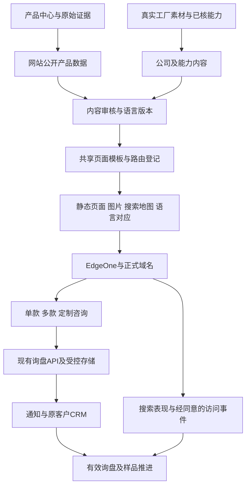

# 贝强独立站产品与架构设计

更新时间：2026-10-29。下节为当前商业改进任务及已验收的正式部署；后续按日期保留实际开发与发布证据。当前公开站已有69款及五语采购前台，不能把下方10月25日37款的阶段记录当今天全站范围。正式版本仍以最新发布回读和实际域名为准。

## 当前商业改进任务：让买家能选择合作方案

主办：Codex当前经营路线图会话；所属阶段：国际B2B A阶段“商业方案投入使用”。本轮已完成并上线：首页3款主推与合作路径、中英文目录公开预览/下载、BQ003/BQ005跳转身份修正。源码变更限于上述范围，其他对话的资料与暂存未改动。正式验收见下文；下一重点转主推样品条件和两类买家提案，网站只按具体采购缺口继续改进。经营方向回[增长总控](../../00_总控台/全渠道增长总控.md)，产品/公司文案与精选结构回[产品矩阵](../../00_总控台/产品中心/产品矩阵与供货能力.md)，页面观察回[研究对照](../../06_市场研究/国际B2B展示与获客对照.md)。

现有视觉、真图、语言与询价功能已复用。后续围绕采购判断改内容与路径，不以增加功能数验收。

2026-10-29资料已具备：[8款/6页精选册](../../04_客户开发/06_报价与产品册/国际B2B精选册/README.md)及内部经济比较已完成；优先承接BQ008、BQ009、BQ031，其他款按采购需求选择。中英文首页已采用该产品组合、实际图及工厂/合作方式内容；[精选目录](https://www.beiqiang.online/line-sheet/)及[中文入口](https://www.beiqiang.online/zh/line-sheet/)可在填写表单前浏览/下载6页精选册和69款完整册。表单用于可选的选款建议，保留既有询盘处理。

同轮发现明确的跳转身份问题：源码 `app/data/products.ts` 中BQ003指向 `1601815020244`，既有产品身份与10月29日正式回读对应BQ005；BQ005指向 `10000043200726`，对应BQ003。本轮已按原产品身份修正为BQ003→`10000043200726`、BQ005→`1601815020244`，正式域名中英文共4个产品页的跳转正确，德法西6页的内嵌产品ID正确（没有独立跳转按钮）。证据为产品中心受控 `数据/.local/主推组合评估/2026-10-29/` 下两个ID的正式回读及原价格复核。精选册BQ003已使用正确ID，不沿用网站错链。

| 顺序 | 页面改动 | 完成依据 |
| --- | --- | --- |
| 已上线：首屏与精选系列 | 首页明确日常休闲鞋、目标买家和系列选择；由主推组合承接。主CTA为Browse selected styles，次CTA为Plan a sample；高级工具放到有关采购步骤 | 买家能从首页找到与业务相关的系列，再看到具体款式与下一步；保留已有有效深链接 |
| 已上线：公开目录 | 公开精选预览与可访问资料；完整需求表移到选款/样品询价阶段。基本浏览不先要求一长套采购信息；需要邮件发送资料时只收必要收件信息 | 访客可先看产品和系列理由；明确区分浏览、取资料、询价三种行为。现有69款PDF仍可深入查款 |
| 首页/目录已改，其他页按需：对外表达 | 移除buyer-safe facts、重复“不是审厂/不是报价/不是订单”等内部说明；以肯定句讲实际工序、公司能力和下一步。必要规格/订单条件集中在相关位置 | 核验规则保留在后台资料，产品前台直接回答买家问题；不把已确认优势一并删掉 |
| 2 样品/OEM | 现款取样、现款改样、新结构开发三条路径；每条说明输入、交付、收费/时间条件，补一个真实改款过程 | 买家能判断走哪条路；有证据的条件可直接展示，未知数字不填通用承诺 |
| 2 工厂与品质 | 复用已确认公司历史与规模、现有真实工序，新增匿名案例和实际检查项目；将长视频拆成对应过程入口 | 每项优势对应资料或案例，能解释怎样服务该系列；不将合作外采说成本厂制造 |
| 2 商品一致性 | 先处理主推款标题、结构、材料、尺码、配色与PDF的一致性；BQ004回原款核Slip-On命名 | 受影响页面、PDF与本地源同步，未核字段留原任务，不批量推断 |
| 3 搜索与归因 | 主推系列分别承接实际采购词与买家问题，记录来源→系列→询价；先取得新搜索数据和表单链路结果 | 有日期与口径的数据，实际提交/通知和合格询盘分开；搜索页数量不是结果 |

首屏与公司介绍直接采用产品矩阵中的英文主稿，再按主推结果调整；不在这里维护第二版公司数字。选款页展示规格和系列差异，样品页展示交付路径，报价阶段补订单输入，避免每个页面都要求客户重新交完整brief。

本轮GSC Wizard返回订阅错误，最新搜索效果未取得；不据旧62次曝光证明现在SEO失败。上线验收沿现有网站SOP：先核独立源码工作区，再修改、必要检查、部署及正式页面验收。转化改善需后续真实数据，部署成功不能代替。

### 2026-10-29正式发布与剩余工作

网站main提交`293567dbe79c215978c7d5d56ed626355be4a523`已推送github/main；EdgeOne部署`dp9p71rt03uj`为Success、UsedInProd=true，正式站版本`2026-10-29.1`。中英文首页主推BQ008/BQ009/BQ031，三种合作路径为现款取样、现款改样和新结构可行性评估；不新增无依据的天数/费用承诺。完整目录保留，精选册与本地核验原件一致。

完整类型、目录、构建/静态导出和384项测试通过；ESLint为0错误、9项既有图片优化警告。正式域名完成11项桌面/390px浏览器检查，无脚本异常，3款主推可加入浏览器本地询价单；中英文4页跳转正确，德法西6页内嵌产品ID正确，3份PDF与本地SHA256一致。两份完整册重建后的32页图像与文字均未改变。没有向生产提交测试询盘或向客户发信。

正式回读及验证范围见[精选系列上线验收](../03_搜索与渠道数据/google-www-beiqiang-online/selected-assortment-production-verification.json)。主推合作条件与两组买家研究/提案已完成，回产品矩阵及获客入口；国际站表达统一继续原任务。页面上线不证明转化改善。后续真实改样案例、主推规格一致性及来源归因按原业务缺口推进。

### 主推报价核查发现的材料冲突（2026-10-29）

BQ009网站`app/data/products.ts`仍写EVA sole，但[9月15日材料纠正记录](../../02_Alibaba运营/02_单品优化记录/BQ系列持续优化_2026-09-14/BQ009材料属性事实修复与恢复记录_2026-09-15.md)及10月29日W1正式回读均不支持该具体材质。负责人10月29日补充“鞋底基本为EVA”，属于总体确认，尚未指定BQ009的各部件版本；按此范围保留说明，不再追问通用材料表。后续网站任务应同步产品短述/鞋底字段、相关语言投影及完整目录，并核正式页面；不可改永久只读的Alibaba源链接。6页精选册对BQ009仅写纺织系带，没有该错误，可用于当前提案。本轮样品/买家研究不改网站源码或平台，当前选款提案以款型、色码和已确认合作方式为主，不依赖鞋底化学材质作为卖点。

## 真实来源配色与细节图库（2026-10-25，第五轮）

- 逐款回到31款工厂原始包及6款对应搜鞋网来源页选图，替换旧营销海报和文字拼版。37款公开图库由205张调整为259张；统一画布比例、缩略图和WebP输出，保留来源背景和完整鞋体，不做AI生成、改色、鞋型修补或背景合成。原包只读。
- 139个既有颜色中136个有对应来源图，35款全部配色可切换。BQ004的Grey Black与既有All Black命名关系未充分确认；BQ019的Cream、White在现有资料中未能可靠分开，3项不强行绑图，仍显示缺图提示。此次没有增加产品、颜色事实、库存或供货承诺。
- BQ-C2627的5张配色图来自供方原始配色合照的矩形局部，记录原图、裁切坐标与哈希，并在图库标题明示“来源配色合照局部”；没有称其为新增独立拍摄，未放大原始像素尺寸。后续优先补该款独立高清照片与鞋底/结构细节。
- 图库增加真实鞋底、鞋面、鞋口、后跟、俯视及上脚视角，按实际内容命名；手持或侧面展示不写作上脚或鞋底。页面取消图片混色效果。来源无法提供的角度不借用其他款、竞品或通用图补齐。
- 每张图对应网站独立仓库`data/product-photo-provenance.json`，保留源文件/公开来源URL、源图和网站图SHA256、用途及局部裁切说明；页面显示标签在`app/data/product-photo-labels.json`。完整本地原路径回[图片来源核验](../03_搜索与渠道数据/google-www-beiqiang-online/product-photo-sources.json)，外采采用的原图按款号保存于产品中心证据目录，临时下载不作为唯一存档。
- 图片版本标识解决原30天浏览器缓存继续展示旧图的问题；已有询价单根据当前款号和保存颜色重新映射图片，不沿用可能已改变含义的图库序号。中英文PDF目录同步封面。259张公开图库、37张产品封面及两份PDF执行正式域名哈希回读；结果回当前发布验收。

本地验收：67项相关检查通过（图片尺寸/体积、逐图来源与输出哈希、配色/询价、目录事实、PDF、服务端页面和比较链接）；生产构建与静态导出通过。最后修正两处图片用途标签后，来源一致性检查再次通过。手机390px与桌面1440px检查了图片比例、配色切换、图库细节、合照标注和询价带色；未向生产提交假询盘。优化后全仓图库WebP共18.91MB、全部目录封面1.52MB，仍在原有自动检查预算内，不等同真实访问性能或转化提升。

发布：网站main提交`445dda0be9219c5677a78072062f83a1613766ed`与github/main一致；EdgeOne部署`dpj5u50ariai`为Success、UsedInProd=true。正式站版本2026-10-25.5；259张图库、37张封面及2份PDF共298项线上文件SHA256均与本地一致，9条页面URL均HTTP200且使用新图片版本标识。正式站验证了BQ018图库切换、BQ-M858沙色独立链接和390px窄屏，未提交线上询盘。当前正式站验收见[产品目录发布验收](../03_搜索与渠道数据/google-www-beiqiang-online/product-catalog-production-verification.json)，实际页面截图在`99_临时区/官网真图补齐-20261025/`。

剩余素材缺口：上述3项颜色身份、C2627独立高清配色及结构图、部分外采款统一白底和鞋底近景。继续从原款资料或新增真实拍摄解决，不用AI或相似款代替。

## 视觉、配色与询价联动（2026-10-25，第四轮已上线）

- 中英文首页、目录和详情统一为暖灰产品背景、炭黑文字/按钮与少量棕灰强调色；调整图片比例、字体、规格密度与留白。首页使用BQ003真实五色图，可选色并进入对应详情；工厂实拍仍在生产介绍区域。
- 对37款现有图库逐款审查，139个既有颜色中建立102个单色实图映射，14款全部配色有对应实图。其余37个颜色只提供文字选择、现有配色合照或通用产品图，并明确“暂无单独实拍”；没有生成、改色或借用其他鞋款补图。映射在网站独立仓库`app/data/product-colour-media.json`，仍以既有产品事实及原始图库为依据，不增加库存或供货承诺。
- 首页、列表、详情和比较表共用选色状态。列表选色切换实图，详情恢复`?colour=`参数；分享单款保留所选色，canonical仍为稳定主款URL。详情画廊保留其他角度、缩略图和放大功能，重新点选当前颜色也返回对应色图。
- “加入询价”带入所选颜色；同款追加其他颜色时合并在一条产品中，保留已有数量、尺码及备注。单款表单、WhatsApp和邮件咨询内容携带所选色。颜色属于该款的校验在选色和本地询价写入时执行；服务端仍按原文本需求字段收取买家要求，不能把自由输入当作已确认配色/库存。
- 复用2–4款比较，新增真实配色选择、显式展开和自动定位。手机两列卡片、触控配色、选好两款后的浮动比较入口及可横向滑动的比较表已验证；详情五色按钮在窄屏一排展示，移除三类页面上遮挡正文的固定联系条。
- 新增205张180px WebP缩略图用于配色和图库按钮；大图仍按需使用原WebP。没有现场Core Web Vitals数据，不将素材缩小等同实际转化或全球加载速度已提升。

本地验收：完整`npm test`共352项通过；最终改动后相关21项回归通过，生产构建和静态导出通过。本轮涉及文件ESLint无错误；完整TypeScript检查仍有9项既有错误，不宣称全量类型检查通过。本地测试服务器捕获BQ003粉色及买家备注的真实浏览器提交请求，未向生产创建假询盘或发送邮件。正式站已验证首页选色→详情、独立颜色链接、同款Pink/Grey合并询价、手机比较左右滑动及三类页面窄屏宽度；测试加入的询价条目已移除。

发布：网站main提交`4cf2b7b69ac560b780a01aa0ffe359930d0e63a7`与github/main一致，EdgeOne部署`dps9csau5uco`为Success、UsedInProd=true。正式站版本2026-10-25.4；9条受影响URL均HTTP200，颜色/比较参数未污染canonical，4张代表图线上哈希与本地一致。完整当前回读见[产品目录发布验收](../03_搜索与渠道数据/google-www-beiqiang-online/product-catalog-production-verification.json)。本轮截图与可重建测试日志在`99_临时区/官网配色改版-20261025/`。

第四轮当时缺口：37个颜色缺少独立实拍、旧营销图与细节不足；图片部分的最新进展以上方第五轮为准。其他待办仍包括完整类型检查修复、颜色选择事件的细分分析及新语言人工审核。第四轮没有新增产品或新语言，也未把来源商品称为畅销款。比较分享目前保留款号组合，单款分享才携带颜色参数。

## 视觉与选款深度复查（2026-10-25，第四轮实施前依据）

本次复查正式产品页和源码，未修改网站源码或发布新版本。Google Trends正常浏览器已恢复三词曲线及CSV，先前429不能继续表述为整项数据不可用，详见[需求研究](../../06_市场研究/鞋类需求与官网扩品研究.md)。GSC Wizard当前为订阅到期错误，尚未取得本站新查询。

对照对象为[BIRKENSTOCK Boston](https://www.birkenstock.com/us/boston-soft-footbed-suede-leather/boston-suede-suedeleather-softfootbed-eva-u_46.html)与[Allbirds Tree Runner](https://www.allbirds.com/products/mens-tree-runners)官方页面。前者具有俯视/侧面/鞋底/材料近景/上脚等明确图像角色、宽度及尺码指南；后者具有六个配色色块、尺码状态、合脚提示和技术信息分层。Allbirds点选Wheat后颜色文字及URL变化，当前检查未完成换图稳定性验证，不将该站所有交互视为无缺陷。BIRKENSTOCK财报披露2026财年第三季度收入7.2亿欧元，为公司规模证据，不代表Boston单款或官网销量，更不能证明设计造成销量。财报来源：https://www.birkenstock-holding.com/news/birkenstock-reports-fiscal-third-quarter-2026-results-with-15percent-constant-fx-revenue-growth-led-by/ea946937-0de8-419e-b169-012ebbc89b2f 。

复查时的真实缺口（对应实施进展见上一节）：

- `Product`把`colors: string[]`与`images: string[]`分别保存，缺少颜色与实图的一一对应。卡片仅封面和配色数量，详情配色为静态文字；已有四图不等于配色可选。画廊替代文字只有序号，未说明鞋底、侧面或配色全貌。
- 目录已经具备2–4款规格比较、分类筛选、比较分享与询价能力，不重复开发同类入口。改进重点是将比较入口、关键差异、真实配色与筛选结果放在买家当前视野中，并带入具体色码需求。
- 详情缩略图使用与大图相同的1000px资源；产品图片可改为按显示尺寸生成响应式版本。当前有WebP和静态页面基础，不能称完全未做性能优化。首屏及图片切换需测真实设备与网络，不凭单次HTTP200承诺访问体验。
- 视觉以深绿、米白、灰绿及细小文字为主；本次正式页截图中右侧规格密度较低，固定联系条占据产品信息区域。需要统筹图片比例、字体、留白和联系入口，而非仅替换绿色。

建议设计方向：暖灰/白作产品底色，炭黑文字与按钮，少量单一强调色。核心规格正文以14–16px起做响应式验证；列表卡使用统一主体比例，显示真实配色缩略图或来源全色图入口、尺码范围及1–2项有证据的差异。首页首屏产品与工厂身份并存，详细工厂内容继续提供实拍和具体工序。合作供货不能变成贝强制造能力案例。避免用AI改色或虚构摄影补齐变体。

建议实现顺序：

1. 产品中心保持事实权威；网站公开投影新增稳定颜色ID、本地化颜色名、对应图片ID、图像角色和来源关联。有来源颜色缺单色图时保留文字/真实全色图，明确尚无单独实拍，不制造可点击却无对应图的假交互。
2. 先用已有真实素材的代表款贯通“卡片看配色→详情选色/看角度→比较→询价保留色码”。URL可携带颜色状态并仍以主款为canonical；主款独立链接保留。分享、返回、语言切换均恢复所选内容。询价接收端校验颜色属于该款，兼容旧询价记录。
3. 共用设计变量统一更新首页、卡片与详情；移动端采用不遮挡信息的联系操作区。筛选按鞋型/结构/尺码/真实材质组织，先使用可解释的规则匹配。缺失数据不按默认值猜测；零结果给出放宽条件的选择。
4. 复用现有事件系统，补颜色选择、无结果筛选、比较后询价等事件，关联到实际有效询盘和样品推进。37款目录优先完善元数据，不先引入向量库或复杂推荐服务。统计不足时不宣称A/B测试显著或转化提升。
5. 技术验收覆盖色图对应、SKU/配色询价一致、深链接恢复、跨语言、键盘与触屏、图片尺寸和移动端遮挡。已有9项类型检查问题需独立修复并回归采购流程，不能以视觉改版通过替代完整工程质量。

产品变体数据完备后再评估[ProductGroup结构化数据](https://developers.google.com/search/docs/appearance/structured-data/product-variants)，不为商品富结果编造价格/库存。性能采用真实访问第75百分位LCP≤2.5秒、INP≤200毫秒、CLS≤0.1作为目标（[Google说明](https://web.dev/articles/vitals)），当前没有测得本轮现场数值。多语言只发布编辑验收完成的版本，不能用增加语言按钮代替真实内容。

## 有来源的品类扩充（2026-10-25，第三轮）

本轮依据与查询限制见[鞋类需求与官网扩品研究](../../06_市场研究/鞋类需求与官网扩品研究.md)。发布时采用Circana美国上半年类别销售与Google官方澳大利亚搜索观察支持小规模补充洞洞鞋和穆勒鞋；当时美国Trends直接请求HTTP429，同日后续浏览器补证见本文复查章节。不宣称销量排名或已验证转化提升。

- 新增BQ-C2627（火火2627BSK）、BQ-CA67（宝多A67）、BQ-M858（华泰K858）。10月25日三个搜鞋网来源页均正常可读；复用产品中心既有身份和实源图，每款四图，原款、色码、材料边界及图片哈希回[产品中心证据](../../00_总控台/产品中心/证据/)。三款均标注合作供应商供货，不作为贝强自产。
- 目录现为37款：31款自有工厂、6款合作供货；25条历史排除草稿仍不公开。新增`clogs-and-vented-shoes`（2款）及`mule-shoes`（1款）双语分类。首页九类入口、默认九款，仍是结构覆盖与主动筛选，不是个性化算法或销量排名。
- 三款均有中英文独立详情、四图、规格、样品评估、供货说明、分享、打印及询价。BQ-C2627为三组双码标签，BQ-CA67为五组双码标签；不直接换算EU/US/UK。BQ-CA67的模压仿鞋带不归系带；BQ-M858只描述绒面效果，不认定真皮/软木。来源确认的EVA只用于两款鞋面。
- 款号贯穿询价单分享、询盘、样品、复购及归因接口；相关产品按结构隔开，避免洞洞鞋与穆勒鞋被默认推入针织系列。中英文PDF目录均37款、10页，修复双码标签换行与颜色文字重叠。
- 分类静态导出原本写死七类，本次改为直接读取分类数据，同时生成正式文件和地图。修复分类页百分比列宽叠加间距造成的横向溢出；canonical、语言对应、产品/分类结构化数据、地图及llms导航同步。
- 本地验收：360项测试通过；生产构建与静态导出通过；ESLint为0错误、12项既有图片优化警告。浏览器验收双语筛选、六个产品详情与图库、双码说明、跨语言询价单、桌面/390px六页无横向溢出、可见图片均加载、单款打印；询盘仅在本地拦截回执验证，没有向生产写入假询盘。完整TypeScript检查仍为九项原有错误，不宣称通过。

第三轮发布状态：网站main提交`77526aa0be0ce843040e7fc0ba706a6989ae2793`与github/main一致；EdgeOne部署`dpljxapl6v2k`返回Success、UsedInProd=true。正式www域名及部署预览均为2026-10-25.3、37款。六个中英文单款页与四个分类页HTTP200，canonical、语言对应、供货身份及结构化数据准确，地图包含十个新增路径；12张产品Web图均200。双语PDF的HTTP、文件长度及PDF文件头与预期相符；完整远程文件哈希未验。正式站浏览器已验证九类入口、洞洞鞋筛选、分类至单款跳转、双码说明、英文穆勒详情及390px无溢出，脚本错误为0。正式回读见[产品目录发布验收](../03_搜索与渠道数据/google-www-beiqiang-online/product-catalog-production-verification.json)。不将HTTP可达解释为Google收录或大陆全线路可用。可重建本地截图和测试日志在`99_临时区/官网扩品-20261025/`。

## 产品发现改进（2026-10-25，第二轮）

负责人反馈：首屏人物背影不适合作为封面；固定四款精选覆盖过窄，应支持买家从具体产品找到工厂。

- 封面改为现有BQ018产品图片，可直接打开单款；同时提供宽鞋头与童鞋系列入口。工厂实拍与完整视频保留在生产介绍区域。
- 首页取消固定四款精选，默认跨系列展示8款；七个可点击方向分别为针织套穿15款、系带休闲16款、宽鞋头4款、童鞋2款、高帮1款、加绒2款、扩展尺码6款。类别存在交集，不应相加为总款数。全部公开产品仍为34款。
- 买家选择类别后就地预览对应产品，完整系列按钮进入稳定分类URL。所有类别均保留真实链接，关闭JavaScript仍可进入分类与产品；首页搜索以查询参数进入目录，canonical不因搜索词生成新页面。
- 首页、目录、分类页使用同一筛选条件与公开产品数据；分类封面必须属于该系列，跨系列默认展示不得隐藏小品类。没有使用销量、热销或用户画像假设，当前实现是买家主动选择需求后的匹配。
- 中英文分类页先展示产品，再呈现订购说明、采购指南和问答；系列间可以直接切换。保持原分类和单款URL、canonical、hreflang与结构化数据。
- 单款页新增供货说明与样品入口；自产款连接工厂介绍，合作供货款说明贝强协调规格、样品及报价，不声称该款为贝强自产。
- 修复手机页头询价单文字挤压，360/390/768/1206/1440px检查无横向溢出。完整359项测试通过；生产构建及静态导出通过；ESLint无错误（全站仍12项既有图片优化警告）。浏览器实测双语七类筛选、童鞋结果仅BQ016/BQ030、分类跳转、搜索到单款、供货身份、无JavaScript导航通过。
- 本次没有增加商品或新语言。童鞋2款、高帮1款等供给缺口需要后续依真实产品与样品补齐，界面覆盖不能等同产品竞争力。单款页已具备独立推广入口；推广内容应直接连接对应产品或系列，后续依据真实查询、选款与询盘数据调整产品组合。

第二轮发布回执：网站main提交`1d60f99da8856679a9441d1fb13c5b4d2d0c2c7e`，本地与github/main一致。EdgeOne部署`dpkaahww3qn4`返回Success、UsedInProd=true，对应该提交。正式www域名返回`2026-10-25.2`、34款；双语首页与14个分类页均HTTP200、canonical准确、实际卡片数匹配且产品位于订购说明前。正式站浏览器验证中英文七类筛选、童鞋结果、分类跳转、搜索至BQ-LQ2597单款、合作供货身份、390/1440px和无JavaScript导航通过，页面脚本错误为0。初次浏览器脚本等待networkidle/load遇到超时；按正文就绪及实际交互组件就绪重验通过，不据此承诺所有资源加载速度或大陆直连表现。此前发布回执保留为首轮历史，不作为最新版本。

本机截图、浏览器交互结果及正式页面回读位于`99_临时区/网站改版-20261025/`，文件前缀为`选款新版`及`选款改版`。

## 核心页面实施（2026-10-25）

- 首轮首页采用真实车间照片、工厂视频、四款代表产品、定制项目说明与合作流程；第二轮封面与选款入口已按上述方案调整。中英文重写，通用咨询进入无需款号的需求表单。
- 产品目录改为简明标题、搜索与分类、比较及产品卡。1440px桌面首排产品距顶部约507px；390px手机约621px。核心三类页面均无横向溢出。
- 详情页共用双语模板，提供缩略图、前后切换、触屏切换、放大/Escape关闭、规格与供货来源、样品询盘、相关鞋款、打印资料。中文打印被外层容器隐藏的问题已修复。相关产品保留成人/儿童及已核宽鞋头边界。
- 网站目录由31款增至34款：保留31款自有工厂商品，新增3款合作供应商商品。未核来源的25款继续不公开；合作款不添加贝强制造商结构化数据，不继承原有通用报价与交期。
- 新款号贯穿目录筛选、选款分享、询盘及关联API；修正大尺码筛选仅接受EU46/47、遗漏EU48的问题。
- 产品独立URL、canonical、en/zh-CN/x-default对应、产品与面包屑结构化数据、地图及llms导航同步；双语PDF为34款、各9页并逐页渲染审查。多语言注册表统一现有核心页面与产品导出，当前仍仅正式提供英文和简体中文，德/法/西等尚未制作。
- 本地验证：完整358项测试通过；npm test和生产静态导出通过；ESLint无错误、12个图片优化警告。浏览器验证桌面/手机、图片加载、搜索、详情导航、画廊、跨语言询价单、分类和单款打印；询盘提交用本地拦截回执验证，未向生产后台制造测试询盘，也未宣称邮件送达已验证。
- 独立TypeScript检查仍有9项旧错误，均位于未修改的采购工作流组件、移动导航和Cloudflare模板绑定；本轮新增组件无该项错误。不得将完整类型检查记为通过。

### 新增产品的来源与网站映射

| 网站款号 | 供应商原款 / 公开采购入口 | 本地证据与图片 | 网站声明 |
| --- | --- | --- | --- |
| BQ-LQ059 | 路崎059；[搜鞋网](https://luqi.sooxie.com/detail/2559453) | 产品中心对应身份；`02_Alibaba运营/05_扩品工程/执行记录/HR实源替换/货号与共用主图/商品/`中1601972951733对应货号与图库记录；四张当前实源图片 | 合作供应商；EU36–48；鞋面成分与鞋底材料待确认 |
| BQ-LQ060 | 路崎060；[搜鞋网](https://luqi.sooxie.com/detail/2560210) | 同上目录1601972944790对应货号与图库记录；四张当前实源图片 | 合作供应商；EU36–48；网面拼接，成分与鞋底材料待确认 |
| BQ-LQ2597 | 路崎2597；[搜鞋网](https://luqi.sooxie.com/detail/2410682) | `02_Alibaba运营/05_扩品工程/执行记录/路崎宽头户外_2026-10-08/2597准备/经营任务包.md`及原图片01/09/18/19；负责人原款确认与2026-10-25页面复核 | 合作供应商；已核宽鞋头，EU39–48；不承诺整鞋宽楦、鞋底材料及性能 |

对应国际站链接分别为1601972951733、1601972944790、1601973797610；本轮未修改国际站。新款选择依据真实来源与既有商品核验，不是Google Trends销量排序结论。图文与网站源代码保存在网站独立仓库，完整来源留产品中心及原执行对象。

本机可复核材料：`99_临时区/网站改版-20261025/`中的浏览器截图、交互验收、测试日志与PDF渲染。无客户资料、凭证或测试访问码进入公开仓库。

### 本轮正式发布回执

- 源码：网站独立仓库main，提交`3861abb9ac767c98e6250927fb6f6e8c02d88858`，GitHub远端与本地一致。
- EdgeOne项目`makers-zsvtdpeh3qf1`，部署`dpc414tod8ic`；官方部署查询返回Success、UsedInProd=true，精确对应上述提交。预览地址`https://beiqiang-footwear-dpc414tod8ic.edgeone.dev`。
- 2026-10-25正式www域名与部署预览均返回releaseId=2026-10-25.1、productCount=34；完整工厂MP4及中英文字幕请求通过。中英文首页、目录及新增英文详情/2597中文详情均HTTP200、呈现新模板；对应canonical和页面语言正确。地图含新款、不含历史排除款。
- GET `/api/inquiries`不代表可提交性；POST空对象实际返回HTTP400及JSON校验错误，确认函数可达且未写入测试询盘。真实询盘保存、附件及邮件送达未在生产新增测试。
- 此发布不修复裸域名证书或证明中国大陆直连可用。用户旧保存链接、大陆线路问题仍按先前边界另行核验，建议本轮审阅使用带www正式入口。

## 目标与已确认要求

负责人已认可：以工厂介绍和定制能力组织首页，突出可直接打开的独立产品页，改善视觉、手机体验、询盘及访问稳定性。本轮补充要求：中文及英文去除AI式、过度口语化表达；增加主流语言；将SEO和AI搜索可发现性纳入产品与技术架构。

核心业务目标：让目标买家准确理解贝强、找到适合的产品，并发起可以推进的采购或定制讨论。有效询盘与样品推进为业务结果；页面数量、语言数量、SEO工具分数和AI提及次数只是辅助观察。

用户要求不等于已确认以下实施细节：语言先后、页面命名和设计规格属于本方案建议；新增市场、供应能力和商业条件仍需各自证据。

## 当前核验与限制

2026-10-25在正式域名及当前源码核验：

- 网站源码main与github远端main核对为`1fae423`。正式域名发布标识为`2026-10-13.1`，标识本身不能证明生产部署精确对应此Git提交。
- 31个产品URL本次均返回HTTP200；首页未展示具体产品卡片。产品目录在1440×1000视口中第一张产品卡距页面顶部约2346px。
- 390px手机视口首页出现408px内容宽度，溢出定位到proof区域；首页大标题及隐私选择面板挤占首屏。
- 首屏及正文大量使用引导式口语，英文同样存在。部分导航和说明混入“证据、候选、人工复核、方向”等内部整理措辞。
- 首页通用咨询按钮进入多款询价；提交实现要求至少一个已选产品。已有无需款号的`/sourcing-review/`可复用。
- 产品列表混用白底、场景及整版宣传图。滚动后主要图片可加载，两个延迟缩略图单独请求也为200，不能把截图空白直接认定为丢图。
- 当前主页面请求主要来自同一正式域名；工厂完整MP4本地资产约15MB，设置preload=none。本轮未发现首屏依赖Google字体或YouTube，不能以此解释整站超时。
- `https://beiqiang.online/`在浏览器与TLS检查均出现证书域名不匹配；带www域名可访问。当前网络有虚拟DNS/代理迹象，不能代替中国大陆直连测试。用户反馈从旧保存链接进入、整站超时，尚未确定具体URL。
- 项目记录维持不备案、加速区域不含中国大陆。该配置不等于大陆必然无法访问，需区分证书、DNS、线路、CDN响应和页面资源。
- Search Console插件本轮返回工具不可用，未取得最新搜索数据。现有2026-10-09存档截至2026-10-06的窗口为62次展示、1次点击、平均位置37.1；仅作历史背景，不用于宣布当前排名、语言需求或增长。

截图和探测原始输出留本机`99_临时区/独立站审查-20261025/`，不随本文进入公开仓库。

## 产品信息架构

主导航建议：产品中心 / OEM与定制 / 工厂介绍 / 品质与包装 / 采购指南；右侧语言与咨询入口。Logo返回首页。客户工作台、查询状态和复杂采购工具退到次级入口，保留现有功能。

| 页面 | 客户核心问题 | 首要内容 | 主动作 |
| --- | --- | --- | --- |
| 首页 | 这家公司做什么，是否值得进一步了解 | 工厂身份、代表产品、真实生产与定制实例 | 浏览产品、咨询定制 |
| 产品中心 | 是否有我需要的鞋 | 统一鞋图、分类筛选、款号和关键规格 | 打开单款、选择询价 |
| 产品详情 | 这款鞋是什么，可以怎么合作 | 多角度图片、已核规格、适用定制项目 | 询问这款、申请样品 |
| 分类页 | 这一类有哪些可比较产品 | 分类定义、实际鞋款、选型差异 | 比较具体款式 |
| OEM与定制 | 可以定制哪些部分 | 项目图例、真实样品、开发范围与流程 | 提交参考或开发需求 |
| 工厂介绍 | 谁在供应，有什么可核实的基础 | 公司主体、真实场地、生产环节、人员与视频 | 联系工厂 |
| 品质与包装 | 如何控制做工和交付一致性 | 实际检查内容、包装实例、可提供资料 | 提交检查与包装要求 |
| 采购指南 | 某个采购问题如何解决 | 直接回答、实务步骤、相关款式和服务 | 选款或无款号咨询 |
| 咨询页 | 怎样开始联系 | 简洁表单、联系渠道、提交成功反馈 | 提交需求 |

### 首页内容顺序

1. 首屏：贝强身份、休闲鞋及步行鞋方向、工厂或产品实拍、浏览产品与定制咨询。
2. 简明工厂介绍：真实车间、主要可展示环节，完整视频按需播放。
3. 产品系列与6—8个精选款：真实图片、名称、款号、一至两项选型信息；不是默认销量排名。
4. 定制项目：商标、配色、鞋面、鞋垫、标签、包装等已具备证据的示例。未知项目只保留咨询入口，不做完成案例。
5. 合作流程：需求评估、样品、规格确认、订单与交付；具体周期依项目。
6. 品质与包装：检查实拍与具体检查项目。
7. 少量关键问答、联系入口。

首屏不自动下载完整工厂视频。无高质量视频时用真实静态照片；首页不要求用户看完视频才能理解业务。采购文章与操作工具不占据主叙事。

### 产品详情

首屏采用图片画廊与简明规格并列；手机先显示产品图片和名称。具备缩略图、放大和触屏切换；颜色图仅绑定真实存在的对应图片。展示SKU、鞋面、鞋底、尺码、已记录配色；未知字段明确写待确认，不用形容词掩盖。

产品卡优先展示鞋，不展示整版宣传海报。宣传图可保留到详情的相关说明处，并核原有声明。正侧面、鞋底、后跟、鞋内和材料细节是补拍目标，不能用AI合成补成实物证明。

通用价格区间、两双起订或交期基线不占单款详情的核心位置，只有适用该款和订单条件时才展示。产品级样品入口与询盘自动携带明确选中的款号；未选规格不自动填成客户确认。

### 询盘设计

三个用户入口复用现有接收和人工处理体系：单款咨询、多款询价、无款号定制咨询。初次联系优先收集联系人、邮箱或WhatsApp、目标市场、需求；公司和数量允许在适当路径后补。是否调整API必填字段须一起实现，不能只改页面。

样品、技术开发和大货详细资料渐进展开；不向首次访客显示内部准备度评分。NDA、技术目标和样品验收边界保留在对应项目步骤。提交失败保留草稿，可重试；成功页显示已接收与下一步。HTTP成功、数据库持久化、通知送达和业务跟进分别验收。

## 文案标准与基础稿

### 写作规则

- 语气：专业、具体、克制。以产品、制造环节和服务为主语。短句不等于口语化；正式不等于口号堆砌。
- 每个标题描述一个业务对象或价值，正文补充事实。避免反复使用“从这里开始、一起看看、谈清楚、让合作更有把握”。
- 删除无证据的“领先、一流、顶级、赋能、全方位、一站式”等形容。英文同样避免空泛愿景及sourcing direction、reviewed candidate等内部语言。
- “待确认”就近说明一次，集中在相应规格、定制项目或交易条件。保留真实限制，不让全站变成重复免责声明。
- 公开文案不得暴露内部供应商等级、评审标签、客户记录或私人项目背景。制造商、供货商与外采款身份按产品中心证据映射。
- 中英文分别写成适合本语言的成稿，含义与事实一致，不逐字复制句式。第三语言按同一事实底稿本地化。

| 位置 | 现有表达或问题 | 建议表达 |
| --- | --- | --- |
| 中文首页标题 | 采购休闲鞋，或做自己的品牌，从这里开始 | 休闲鞋与步行鞋制造 · OEM与品牌定制 |
| 英文首页标题 | Walking shoes for your business. A factory to work with. | Casual & Walking Shoe Manufacturing |
| 中文工厂模块 | 先看看鞋子是在哪里做出来的 | 贝强工厂与生产流程 |
| 英文工厂模块 | See the work behind the shoes. | Inside the Beiqiang Factory |
| 定制模块 | 想改哪里，我们一起具体沟通 | 品牌定制与样品开发 |
| 未选款咨询 | 申请人工复核 | 咨询产品与定制 |
| 图片说明 | 供应商背景、工作区域实拍证据 | 工厂外景、鞋面车缝、包装准备 |
| 按钮 | 告诉我们您想做什么 | 咨询定制 / 查看产品 |

首页中文介绍基础稿：

> 泉州贝强鞋业服饰有限公司位于福建泉州，面向品牌商、进口商及批发客户，经营休闲鞋与步行鞋OEM/ODM及批发业务。现有鞋款、品牌定制与来样开发需求分别评估。

首页英文介绍基础稿：

> Based in Quanzhou, China, Beiqiang supplies casual and walking shoes to brands, importers and wholesalers. Explore our footwear range or enquire about private-label and OEM/ODM projects.

按钮：Browse Products / Discuss Customization。该基础稿为编辑方向，不自动证明每件展示商品为自产，也不承诺所有定制要求可实现。

术语表至少覆盖：宽鞋头与宽楦分别表述；Slip-on不译成Hands Free；样品开发、品牌贴牌、OEM/ODM、鞋楦、外底、鞋垫、装箱、MOQ与交期保持范围一致。产品数值、材料及货号不得由翻译模型改写。

## 多语言策略

建议首批形成五语完整采购入口：英语、简体中文、德语、法语、西班牙语。优先服务既定欧美买家；这是市场定位下的产品选择，不是现有流量已证明的语言排序。葡萄牙语（巴西）与阿拉伯语作为后续扩展位；俄语、日语等依据实际询盘及维护能力再加入。

每个首发语言必须覆盖：导航、首页、工厂、定制、品质、产品中心、已发布单款详情、咨询表单、校验错误、成功状态、隐私与条款入口，以及相应搜索标题/描述。深度文章与客户工作台按本地化完成度独立发布，入口清楚说明可用语言，不能以五语首页宣称全功能五语。

| 语言 | 路径 | 备注 |
| --- | --- | --- |
| English | 保持现有`/`、`/products/bq001/`等 | 不为目录整齐迁移既有英文URL |
| 简体中文 | 保持`/zh/` | 对应zh-CN |
| Deutsch | `/de/` | 适配德语长词和较长按钮 |
| Français | `/fr/` | 独立标题、正文、表单校验 |
| Español | `/es/` | 首期通用西班牙语，不虚构当地仓库或经营主体 |
| Português (Brasil) | 预留`/pt-br/` | 后续有完整审核内容才启用 |
| العربية | 预留`/ar/` | 需RTL排版、数字/货号方向测试后启用 |

实现要求：语言切换到同一个产品/内容对象；不因IP强制跳转。缺少已发布译文时不生成伪翻译页，不把英文正文放到新语言URL索引；显示可用版本说明。每个语言页canonical指向自身，hreflang列出实际已发布的互相对应页面，含自身与英文x-default。

翻译流程：已核产品事实→中英文编辑底稿→术语约束的翻译→数值/材料/承诺一致性检查→关键页面语言审核→页面实测→发布。没有母语审核的版本明确记录审核级别，不能报告已完成母语审校。图片内文字需要本地化或改为可读HTML；视频优先增加对应字幕，PDF单独记录版本与可用语言。

## 技术架构决定

继续使用现有React/TypeScript、静态公开页面与EdgeOne服务基础。先解决重复模板、内容数据和发布一致性，不在此次设计中引入新框架、外部CMS或微服务。若非技术编辑人数增加、内容更新频率明显提高或Git内容工作流成为瓶颈，再评估CMS。

### 数据与代码职责

| 对象 | 职责 | 约束 |
| --- | --- | --- |
| ProductRecord | 稳定产品ID、网站款号、尺寸、材料、配色、图片映射 | 来源仍为产品中心；不建立新的产品事实权威库 |
| PublicProduct | 页面与浏览器可见的白名单字段 | 内部等级、采购入口及私人字段不直接序列化到客户端 |
| ProductTranslation | 对应语言的名称、介绍、标签、图片说明与SEO文字 | 引用产品ID，不复制规格数值为独立事实 |
| CapabilityRecord | 定制项目、支持材料、适用范围、关联款式 | 工厂通用方向不自动继承到所有SKU |
| PageContent | 首页、工厂、定制、指南的内容对象 | 区分草稿、已审核、已发布；关联来源版本 |
| LocaleRegistry | 启用语言、语言代码、文字方向、默认回退 | 未审核语言不能仅凭目录存在即公开 |
| RouteRegistry | 内容ID、语言、URL、索引意图和发布状态 | 唯一生成导航、静态导出、hreflang和sitemap的输入 |
| MediaManifest | 角色、产品ID、角度、颜色、来源、语言及尺寸 | 主图、详情、工厂实拍和示意图区分 |
| Inquiry | 三种询盘类型、产品ID、语言、用户输入、来源与处理状态 | 复用现有接收链路；客户数据受控，不进入公开Git |

当前迁移重点：

1. 将BuyerHome中内嵌双语字符串、ChineseProductCard等重复页面逻辑，逐步转为共享模板与语言资源。保留现有URL适配层。
2. `app/sitemap.ts`与`scripts/export-edgeone-static.mjs`当前各自维护路由/语言清单，应统一从RouteRegistry生成，避免开发环境正确而正式导出缺页。
3. 当前中文layout运行脚本改lang，但正式导出另有替换。改造时从页面构建上下文直接生成正确lang/dir，不能把代码中的英文根标签误报为已确认生产错误。
4. 同一套设计变量负责字体、字号、间距、颜色、按钮、表单、卡片和断点；共享组件支持语言长度变化。
5. 公开页优先静态完整HTML，仅画廊、筛选、询价清单及表单交互加载必要脚本。关键内容不等待翻译API或登录后才出现。
6. 保留既有询盘ID与接口兼容性。新增locale和inquiryKind等字段采用向后兼容校验；旧记录无语言时保持未知或既定默认，不改写历史原文。

### 安全、访问与稳定性

- 先修裸域名证书及域名绑定，再将裸域名和HTTP入口永久跳转至`https://www.beiqiang.online/`，保留路径及合法查询参数，避免循环。
- 大陆验证需真实直连测点，覆盖电信、联通、移动；海外覆盖主要目标地区。记录DNS、TLS、状态码、首字节和资源加载，不能仅用ping或本机代理判断。
- 海外加速区域维持现有业务决定。若中国大陆访问有持续业务需求，再以测量结果比较可用线路/服务与备案方案；不是本轮默认更改地域或购买付费服务。
- 客户私有内容必须通过身份和权限检查。robots只是抓取提示；不承担访问控制。私有页不进地图，并配置适当noindex与私有缓存策略；已索引页面移除需单独处理。
- 保留现有上传、鉴权、通知与敏感数据边界。附件不进入公开媒体目录。询盘提交防重复、限流和输入校验按现有API实现核验。
- 生产记录使用可核对的releaseId与提交关联；页面、函数及数据契约分别记录，回滚不可丢询盘或重置客户草稿。

## SEO与GEO执行设计

### 需求研究与目录扩充

按[需求证据方法](../../06_市场研究/需求证据与扩品方法.md)分别使用Google Trends、GSC、关键词估算和有范围的销售证据；需求、采购意图和供货能力交叉判断。当前已取得美国三词12个月Trends与官方CSV，范围及其他缺口见[鞋类需求与官网扩品研究](../../06_市场研究/鞋类需求与官网扩品研究.md)，不能将三词结果扩大为全部关键词已验证。

官网当前37款不是长期业务上限。产品中心259条身份记录与网站25条历史排除草稿均须逐款判定，不整体导入、整体解锁或因外采一律排除。BQ-LQ2597、BQ-LQ059、BQ-LQ060、BQ-C2627、BQ-CA67、BQ-M858已接入并上线，但不因此称已证实畅销。

产品公开模型将供货身份与发布状态分开：来源成立、可公开事实、可用素材和语言内容决定发布准备度；自产/外采决定制造身份和能力表述。公司工厂页不能被外采款详情引用成该款的制造证明。制造商未经证实时省略该字段，不能默认贝强；价格和库存也不为富结果资格补造。

新增洞洞鞋、穆勒鞋等需准确的结构分类，不塞入针织系列或强制标为系带/套脚。保持产品中心稳定ID，沿用已有网站URL；新款URL不占用相似数字的历史款。公开目录、图库、API可接受款号、语言版本、搜索地图和静态导出从一致的发布清单生成并校验。网站不复制内部采购成本、供应商联系方式或客户材料。

### 搜索意图与目标页面

| 买家意图 | 优先页面 | 内容要求 |
| --- | --- | --- |
| 寻找休闲/步行鞋制造与供应商 | 首页、工厂、相关分类 | 公司身份、真实产品范围、生产信息 |
| 寻找针织套脚或系带鞋 | 对应分类 | 实际可比较鞋款及选型差异 |
| 自有品牌与OEM需求 | 定制页、现有相关方案页 | 定制部位、真实案例、样品范围 |
| 确认具体鞋款 | 稳定产品详情URL | 真实图片、规格、款号、相关产品 |
| 样品、MOQ、包装等采购问题 | 现有采购指南 | 直接回答、条件、实例和适当咨询入口 |

这些是待以查询数据核实的意图假设，不是已证明高搜索量关键词。先做页面与意图映射，再决定是否合并相近方案页。一个意图应有清楚的主要承接页，避免首页、分类和文章重复堆同一标题。

技术基础：正确HTTP状态、可读正文、有效内部链接、稳定URL、规范域名、逐页唯一标题/描述、真实语言对应、产品图片及工厂视频可抓取。已有合适URL保留；必要合并逐条301，不把所有旧页导向首页。筛选/排序/比较参数只生成用户状态，不无限创建可索引的搜索组合；精选分类使用固定URL。

结构化数据从真实内容生成Organization、BreadcrumbList、Product及适用VideoObject。产品制造商身份逐款取证；未确认实价、库存、评分、认证不为满足检测工具补造。Product语义正确与Google商品富结果资格是两种验收。问答首先服务用户，不以FAQ特殊展示作为增长前提。

### AI搜索可引用性

重点是：网页可访问、公司身份一致、产品事实明确、回答具体、有真实资料可核验。工厂、定制、样品和产品页都用文本呈现核心事实，不把信息仅写进图片或PDF。内容可采用简明回答、参数表、适用条件、真实图例和更新时间，但不重复添加模板段落。

OAI-SearchBot允许与CDN访问分别核验；ChatGPT-User和GPTBot用途不同，开放训练不是搜索曝光的前提。llms.txt保留辅助导航角色，不承诺凭该文件得到AI推荐。Google明确其AI搜索功能继续适用SEO基础，没有专用Schema或额外AI文件要求。

站外身份和引用只来自真实公司渠道、行业合作、资料与可公开案例。不得制造客户评价、假认证、批量低质文章或付费垃圾链接。含客户信息的案例需相应公开授权。

## 设计与验收标准

以下为拟定目标，不是当前已达到的指标：

- 桌面1440×900及手机390×844，首次进入产品目录无需经过长介绍即可看到首排鞋款；首页首屏体现公司身份及至少一个主要动作。
- 360、390、768、1440px宽度无横向溢出；德语长文和阿拉伯语预留布局分别验证。图片加载不导致明显跳动。
- 文字、图像、按钮形成层次。键盘可操作菜单、语言选择、画廊和表单；可见焦点、清楚标签、错误关联与足够对比度。隐私选择不遮挡核心内容或把拒绝隐藏。
- 每个已发布产品有可访问的详情；图片、SKU、规格及语言页面对应正确。非现有图片不虚构颜色/角度。
- 每条咨询路径无需误选产品；提交成功、持久化、通知和人工查看分别核验。切语言与返回页面不丢已选款和已填写需求。
- 发布语言无漏译关键标签和错误信息；标题、描述、正文、canonical、hreflang、lang/dir匹配；未发布译文不进入索引地图。
- 真实用户Core Web Vitals目标：第75百分位LCP≤2.5s、INP≤200ms、CLS≤0.1。没有足够现场样本时记录“暂无现场数据”，实验室结果仅作为开发参考。
- 首页完整视频按需加载，首屏图片使用合适尺寸和现代格式。性能预算在三类页面样板实测后确定，不将本机一次load时间当成全球用户体验。
- 构建、必要功能检查、静态导出、线上页面与接口验收分开；没有最新GSC回读不能宣称已经重新收录。

## 推进顺序与结果评估

| 阶段 | 交付物 | 完成依据 |
| --- | --- | --- |
| P0 访问与路径 | 裸域证书/跳转修复、访问测量、通用咨询路径修正 | 真实域名与三种咨询入口验收 |
| P1 产品与视觉样板 | 首页、产品目录、单品详情的中英文成稿及桌面/手机样板 | 内容真实、鞋款直接可见、样板可操作、评审问题已处理 |
| P2 共用架构 | 统一产品公开模型、模板、语言与路由登记 | 既有URL保持可用、版本一致、必要回归通过 |
| P3 多语发布 | 完整德/法/西首发采购路径及语言审核记录 | 无伪翻译页、无错链、表单及搜索元数据一致 |
| P4 搜索与内容 | 查询映射、重点页面完善、真实定制素材、必要站外身份维护 | 抓取/索引回读与采购动作分别记录 |

监测：首次生产发布前取完整基线；之后以7天检查故障、28天观察页面与语言趋势。搜索数据注明报告日期和延迟。样本不足不做可靠增长归因，也不作未经支持的A/B显著性判断。

主指标为有效采购询盘及样品讨论推进；辅助指标为非品牌目标查询的展示/点击、产品详情访问、咨询开始/成功、失败率、来源和语言。表单点击不等于询盘，WhatsApp跳出不等于已联系，AI提及不等于引荐或成交。数据遵守原分析同意机制，拒绝分析或无法识别来源时保留缺失。

本节为最初设计范围；实际已上线的视觉、产品发现、品类扩充及配色询价进展以上方各轮验收为准。新语言内容、最新搜索数据回读与尚未实施的架构改造仍是后续工作，不因设计已列出而视为完成。

## 当前产品目录与图库（2026-10-25.6）

- 正式产品69款：31款原始工厂款、38款已核来源的合作供应款；本次新增32款。产品中心259条身份记录、192条已采用来源不等于全部已满足官网图片与事实审核条件，未核款不批量放开。
- 真实来源照片586张。新增款来源页面32/32已重新读取，图库与原始文件逐图保留哈希及裁切记录，不使用AI改色。BQ004灰黑、BQ019奶油色/白色缺独立实拍，已移出公开配色。
- 配色切换只展示已确认同色照片；全款图片另列。BQ003、BQ009、BQ018、BQ031共18个配色组已增加角度；BQ018薰衣草紫7张，全款19张。其他未确认配色的细节仅在全款图库，不冒充某一颜色；仍有配色待补拍。
- 新增32款独立中英文URL、四类导航、搜索地图、询价与比较识别；目录PDF更新为69款/16页。四位数字BQ款号可正常带颜色进入询价。
- 网站提交 `2aa6c7a6dcae644ee1cc954cb91b1eba09f25ac8`，部署 `dp90yxo2k3c1`，EdgeOne确认Success且UsedInProd。生产逐图/路由验收见 `../03_搜索与渠道数据/google-www-beiqiang-online/product-catalog-production-verification.json`；来源记录见同目录 `product-photo-sources.json`。
- 构建与静态导出通过；图库、来源、询价等对应测试通过。桌面及390px手机实测配色图库和选色带入询价。全项目类型检查仍有9项原有错误，本次不宣称全项目类型检查通过。HTTP可访问不等于Google已收录。
- 素材改为原始/成品两层，3185个唯一成品、147处重复引用合并；35款当前货号同步。成品使用当前BQ款号，旧HR/LQ来源身份保留追溯；原始字节与正式回执不改写。现行档案已更新路径，历史路径由素材索引解析。旧编辑素材和原始实拍分清证据，不因进入原始目录就升级为真实产品证明。

## 持续产品开发：选款路径与公开身份（2026-10-25.7）

### 外部观察、需求与优先级

2026-10-25公开读取 [Rothy’s女士鞋目录](https://rothys.com/collections/womens-shoes)：按鞋型组织产品，并提供穿搭、适配和尺码说明。读取 [Portugal Shoes](https://portugalshoes.com/)：明确展示产品类别与提交开发需求、项目评估流程。观察只用于信息组织，不证明销量，也不继承其材料、认证、产能或交期。Allbirds目录本次读取不稳定，不将其未读取的动态筛选当成证据。

结合本网站代码和页面审查，P0为旧型号对外混杂；P1为69款目录缺颜色/尺码、拉链结构无法筛选、筛选不能恢复和零结果无复原入口；P1维护问题为中文/英文各一套筛选实现。该轮已实现：贝强公开型号，颜色方向/已记录EU范围/动态穿脱方式筛选、数量反馈、可移除条件、清空、分享URL、返回恢复与加载数量记忆；移动端折叠筛选。颜色条件同步卡片真实配色，所选颜色可继续进入详情与询价。

尺码筛选只识别明确EU范围；不把混合双码、未知尺码或供货状态转成EU库存。复合色可归入多个颜色方向，实际款色以照片名称显示。默认排序为款号，取消“新旧”措辞，避免款号顺序冒充上新日期或销量。

### 架构评估与实现边界

- `catalog-selection.ts`：纯函数负责条件校验、序列化、组合筛选、真实配色匹配、记录尺码范围及排序；与UI语言解耦。
- `useCatalogSelection.ts`：只负责URL状态恢复和交互，不混入事实采集或供应确认。
- `CatalogFilters.tsx`：中英文共享表单、条件标签、结果数、空结果复原。分类复用现有discovery登记，穿脱方式由公开产品集合生成。
- 当前69款继续采用静态公开目录与浏览器内筛选，保留现有稳定产品URL和canonical；无需求证据时不新增搜索服务或微服务。以后目录与查询负载超出实测预算，再评估服务端索引。
- 对外模型以BQ款号为唯一展示标识；供货模式与逐款证据仍分别核验，删除旧型号展示不会把外采升级为工厂自产。来源处理和UI逻辑不互相承担职责。
- 验收覆盖条件交集、未知参数、无证据EU转换、配色图片绑定、中文查询、多端布局、返回恢复、选色询价。构建、部署和线上生效分别验收；不以文档完成代替发布。

### 本轮正式验收

网站main提交 `297c26cf879e16d402d0b877d9b348f3ba1b417c`，版本 `2026-10-25.7`，部署 `dpsa4d85n6w4` 已确认Success且UsedInProd。32项针对性测试、正式构建与静态导出通过；正式域名10个受影响页面、两份目录PDF与本地哈希一致，560个唯一原始图片文件核验通过。详见[本轮线上核验](../03_搜索与渠道数据/google-www-beiqiang-online/catalog-selection-production-verification.json)。不将针对性通过表述为全项目类型检查通过，既有9项类型错误仍待独立修复。

正式页面实测“拉链＋黑色＋EU40”得到BQ1041和BQ1059，两张卡片匹配黑色实拍并带入详情；返回恢复条件，零结果可清空恢复69款。390px手机筛选可折叠，无横向溢出。未发送真实询价。

日常资产目录仍为原始/成品两层，旧批次及路径索引已移至工作区外离线目录；当前原始素材路径无HR命名，原始字节不改写。3185个唯一成品保持去重，当前索引不再附带历史路径列表。内部供应事实与正式业务回执仍按原对象维护，不因对外统一款号改变货源性质。

### 后续产品需求

优先继续补齐高意向款的同色细节图和实测规格；每个缺口关联真实款号，不用AI补造。下一轮根据实际搜索无结果词、目录到详情及询价开始/成功数据决定扩品和内容顺序；当前没有足够数据，不能宣称筛选已提升转化。多语言扩展复用共享选款组件，新增语言仍需完整采购路径翻译与审核。比较表和询价中的身份、颜色与用户输入继续以同一产品公开模型验收。

## 德语、法语与西班牙语采购前台（2026-10-25.8）

负责人要求新增语言后先开发自测，再按产品视角走完整采购体验并回改。本轮按同一执行者的开发检查与产品体验两阶段完成，不将自动检查或模型语言审核表述为独立人工母语审校。

### 发布范围与架构

新增德语、法语、西班牙语，各82页，共246页：69款产品详情，以及首页、目录、选款、询价、定制需求、工厂、采购指南、OEM/ODM、检查包装、样品流程、隐私、使用条款和目录语言入口。英文、中文继续保留原有采购后台与扩展工具。2026-10-26已补齐德法西语PDF目录及首次询价回执；工厂视频旁白/字幕、其他项目通知及高级项目流程仍按中英文提供，相关入口明确说明实际语言。未翻译的二级资源、方案和工具不生成假对应URL，也不写入新语种hreflang。

三种新语言共用页面组件和独立文案/商品术语字典，复用原产品记录、真实配色映射、筛选判断、选色状态、询价清单、标签页草稿格式、统计同意及询盘接口。买家输入保持原文；后端保留标准款号、颜色和期望回复语言。公开页面按实际覆盖生成lang、canonical、互相对应的hreflang和搜索地图。新增语种并不确认团队人员的口语能力，因此未扩大Organization联系人的语言承诺。

### 产品体验与回改

| 实际体验发现的问题 | 回改及验收 |
| --- | --- |
| 带字母的稳定历史产品URL被新语言覆盖判断遗漏 | 扩展实际产品路径匹配；246页逐页核对语言、正文和相互对应链接 |
| 比较区只有规格，难以判断当前配色 | 补真实配色图、颜色选择及带配色的详情链接；法语手机端实测两款黑色比较 |
| 中英文手机菜单被页头形成的定位范围裁切 | 菜单通过portal挂到页面根部；390×844实测抽屉从顶部覆盖完整高度，五语言入口可见 |
| 浏览全款图片会清空询价所选颜色 | 图片浏览范围与询价颜色分离；BQ018薰衣草紫查看19张全款图后仍保留该配色并可加入询价 |
| 手机初始筛选占据过多首屏空间 | 手机默认收起，桌面展开；保留条件及结果数 |
| 新询价表需要明确买家角色 | 增加本地语言买家类型选择，标准值继续复用原后端定义 |

### 验收边界

已走查德语首页→筛选→比较→切法语→详情/配色/放大→加入询价→填写需求→切西语→失败恢复→成功回执，并回归中文手机菜单及选色。表单使用原询盘处理器配合本地测试存储，关闭邮件；确认保存Yellow、EU40、数量/备注及es回复偏好。没有向生产环境提交测试询价，也不声称本轮验证了真实邮件投递。

2026-10-26遗留修复后，全项目类型检查为0错误，生产构建与静态导出通过，完整384项自动测试通过；全库ESLint为0错误、11项已有图片优化提示。发布构建固定先执行类型检查，默认测试包含全部测试文件；原有按37款和旧货号验收的规则已改为当前69款及贝强公开身份，并保留材料、来源与供货边界检查。正式部署和域名回读见[多语言上线验收](../03_搜索与渠道数据/google-www-beiqiang-online/multilingual-production-verification.json)。

德、法、西语PDF各20页、69款，逐页目视检查并核对207个对应语言的产品链接；PDF由同一产品记录及术语字典生成，内容指纹在产品字段或文案改变后要求重新生成。初次询价回执按买家选择的五种回复语言生成，未知语言安全回退英文，邮件失败不影响询盘保存；使用注入邮件服务验证，没有提交生产询盘或声称真实邮件已送达。其他项目通知未纳入此次五语扩展。

新增语种产品详情补齐面包屑结构化信息及本地语言打印资料，资料中的真实图片、颜色和详情链接跟随已选配色；法语选色与西语打印模式浏览器复验通过。390px德语目录页无横向溢出，深色页脚文字对比度偏低已修复。正式站复验发现桌面产品页缺少启用grid的样式，导致图片整行放大、规格下移；已恢复双栏，1280px桌面和390px手机分别复验，手机仍为单栏且无横向溢出。工厂视频字幕、部分二级文章、品牌概念工具及受保护项目流程仍按中英文提供；没有把三个语言入口解释为整站所有工具五语同等覆盖，也没有声称经过母语人工审校。

发布期间首次部署虽然被平台标为成功，正式域名和预览域名却把不同页面及静态资源都返回为英文首页，因此未作为通过记录。发布适配配置补齐明确的构建、安装和输出目录，并对最终发布目录中的五语页面及引用资源进行检查；随后提交 `d2b384fde2a6628f432e40325b0aaa7d2d6cea94`、部署 `dplcl9ruzu64` 正式生效，版本文件恢复为JSON，法语首页、图片和五语言菜单浏览器验证通过。该修复后的表现已验证；未将平台内部异常原因推断为已证实事实。当时构建目录清理被自动审批拒绝，CLI缓存与锁文件未提交；2026-10-26核对实际路径及链接后，将这两项可重建缓存可逆地移至99_临时区，并在部署目录补齐忽略规则，实际项目不再混入这些临时文件。

2026-10-26正式交付：网站main最终提交 `7709f7b3ef14e029c53845f7a49395094f01c404`，部署 `dpkkzijf5833` 为Success且UsedInProd，正式版本 `2026-10-26.2`。回读48个新增语言代表页面、4个中英文页面及246个新语言搜索地图条目；三份新增PDF正式下载均为200，文件哈希与本地验收件一致。正式法语详情的双栏布局、URL选色和打印入口经浏览器核验。本轮范围按负责人确认收口于客户入口PDF目录和首次询价回执，未扩展高级项目流程翻译。

## 私有经营工作台

2026-10-29负责人认可将经营工作台放到官网，通过唯一管理员邮箱跨设备使用，并向云端执行迁移。入口为 `/admin/workbench/`；管理员地址与会话密钥仅配置在现有EdgeOne项目环境，不嵌入公开源码。应用能力和接续步骤只维护在[工作台入口](../../08_工具链/08_经营工作台/README.md)。

网站最终提交 `00c8146` 已推送main，正式版本 `2026-10-29.3`；部署 `dp3l1vkw7ri9` 为Success且UsedInProd，正式域名及该部署预览的版本、视频与字幕均通过核验。构建、类型检查及395项整站测试通过，代理修复后12项专用测试通过；覆盖服务端鉴权、一次性链接并发、会话过期、跨站请求、私有快照、排队、执行领取与版本冲突。新增代码无lint错误。

正式匿名回读：登录状态为未登录，任务与原文接口均401且private/no-store。实际浏览器首次申请登录遇到内部代理URL与公网Origin不同导致403；改为严格核服务端配置的公网Origin，保留会话、CSRF和跨站限制后，正式登录邮件请求通过。负责人已确认“已进入后台”。默认部署核验脚本仍包含旧Sites备份（版本2026-09-08.2），整组会报不一致；正式网站及当前EdgeOne预览已单独验收通过，不把旧备份称为同步完成。

本版后端只支持 `snapshot_review`：四份白名单业务文档快照、七张任务和经营目标已通过既有部署管理员身份导入专用私有Blob存储，逐份原文/哈希及任务回读一致；未伪造浏览器会话，也未把资料打包进公开页面。匿名请求不能读取业务数据；云端可持久保存队列与提案，执行器未连接时如实显示离线。有原文改动的提案禁止在云端采纳，避免与本地权威文件分叉。未实现自动同步、云端模型执行或新增外部发送；这些仍是后续接通和验收项。2026-10-30更正：负责人优先选择OpenAI托管的Codex Cloud与现有套餐，不要求自购云主机。官方连接器已核仅两个仓库，贝强经营工作台托管环境已发布且仅本人可用，Sol云端初始化的396项网站测试及17项工作台测试通过；当时官网队列提交及回传尚待接通。自托管CLI仅保留备用，详细进度回工作台应用入口。

2026-10-30官网连接层更新：main提交`c3fc3f8`，版本`2026-10-30.1`，部署`dpveh5n7o793`确认Success且UsedInProd；正式域名与部署预览的版本、视频和字幕验收通过。399项完整测试、类型检查、构建及lint通过（9项既有图片提示）。手动Cloud模式要求明确run_id，保留原自托管模式；任务卡新增复制执行指令，界面分开显示网站已配置、实际领取任务和无常驻自动派发。

上述连接层先完成本机调用正式接口的指定领取、进展、续租和结果回传，model=protocol-test；首次即时事件回读断言失败后，只读回查确认原事件与结果已存，没有重新执行。后续负责人完成Only me环境网络密钥保存及发布，原生Sol实际回传也已通过；真实运行、失败记录及当前接续边界只维护在[云执行验收](../../08_工具链/08_经营工作台/cloud-runner/README.md#原生sol实际回传验收2026-10-30)。网站自动派发与审核回写仍未实现。

2026-10-30业务分类入口更新：main提交`448856f`，正式版本`2026-10-30.2`，部署`dp1zqjgjje7q`确认Success且UsedInProd。新增国际站运营、独立站增长、外贸开发、国内抖店、内容创作、总控与工具六类入口，按原项目来源筛选任务，并提供复制接续指令；空类如实标明未导入。总览优先展示业务，Cloud配置说明放任务执行页；未新增自动创建对话或平台操作。完整399项测试通过，最终文案/显示调整后类型检查及构建再次通过，lint为0错误及9项既有图片提示。桌面分类筛选、空状态、复制提示与390px手机布局通过本地假数据界面验收，手机无横向溢出；假数据服务与截图不代表生产私有资料或真实经营运行。正式域名与部署预览版本、视频和字幕一致，进一步部署证据保存在`99_临时区/工作台应用验收/`。

2026-10-30审阅回写更新：main提交`0dfac57`实现带来源hash/版本的v1提案导出及“确认已在项目回写”；后续`75a7e11`补齐重复导入前自动核对现有版本，最终版本`2026-10-30.4`、部署`dpfe70bne26s`确认Success且UsedInProd。导入元数据仅管理员可读，原四份文档范围未扩大；明确旧版本和提交前版本变化均停止，不自动重试。确认接口只核历史快照应用提案后的结果与新导入快照一致，再更新运行审阅记录，绝不直接改本地文件或宣称自动同步。

最终406项网站测试通过，类型检查、构建及改动文件lint通过；全站lint仍为0错误和9项既有图片提示。本地回写工具13项Linux测试全部通过。真实Sol提案已完成本地原文审查、精确写入、快照9→10及服务端确认；验收调用复用同一确认函数与既有部署管理员身份，没有伪造浏览器会话。后续业务摘要刷新为文档11/任务10，原提案回执保留。实际链路证据与使用方法回[云执行入口](../../08_工具链/08_经营工作台/cloud-runner/README.md#云端提案经本地审阅回写)。

本地假数据页面确认按钮及状态变化已验收并留图。导出点击后首次查找未发现文件，内部下载页被浏览器安全策略拒绝后未绕过；2026-10-30按Windows实际下载目录复查，找到该次浏览器下载文件，核对v1结构、样例运行、来源hash/版本及变更内容均与界面样例一致，浏览器下载落盘验收完成。这是本地假数据界面验证，不代表生产客户资料下载；实际私有提案文件另已通过复用导出函数验收。精确文件与比对结果留在`99_临时区/工作台应用验收/proposal-download-readback.json`。正式域名和部署预览版本、视频、字幕一致；公开页面代码不包含业务资料，私有接口继续拒绝匿名读取。

## 官方依据

核验日期：2026-10-25。以下用于方法依据，不替代贝强站点实际验收。

- [Google多语言与多区域网站](https://developers.google.com/search/docs/specialty/international/managing-multi-regional-sites)：独立语言URL、可见语言及用户选择。
- [Google语言对应标注](https://developers.google.com/search/docs/specialty/international/localized-versions)：同一内容的语言版本关联。
- [Google AI搜索与网站](https://developers.google.com/search/docs/appearance/ai-features)：SEO基础继续适用，不保证索引或展示。
- [OpenAI爬虫说明](https://developers.openai.com/api/docs/bots)：搜索、用户触发抓取及训练爬虫用途区分。
- [Google产品结构化数据](https://developers.google.com/search/docs/appearance/structured-data/product-snippet)：商品语义与搜索展示要求。
- [Google Core Web Vitals](https://developers.google.com/search/docs/appearance/core-web-vitals)：真实体验指标目标。
- [EdgeOne域名与区域说明](https://pages.edgeone.ai/document/domain-overview)：域名与加速区域边界。
