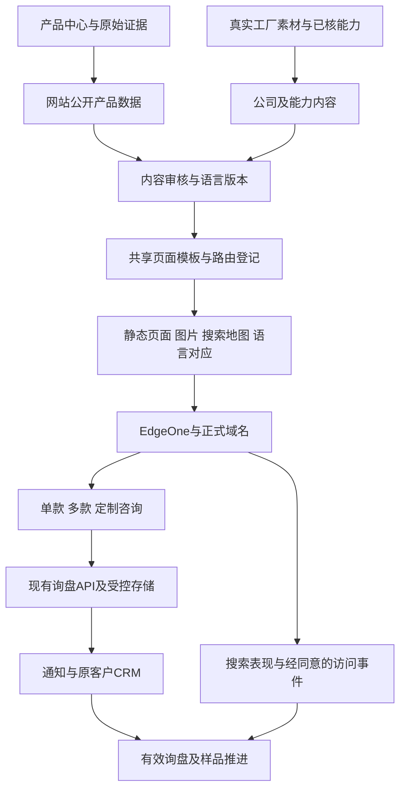

# 贝强独立站产品与架构设计

更新时间：2026-10-25。状态：第三轮有来源品类扩充已上线，正式域名已核验为2026-10-25.3，共37款。本文同时维护后续设计与实际实施范围；未实施的语言与功能不视作已上线。

## 有来源的品类扩充（2026-10-25，第三轮）

本轮依据与查询限制见[鞋类需求与官网扩品研究](../../06_市场研究/鞋类需求与官网扩品研究.md)。Circana美国上半年类别销售与Google官方澳大利亚搜索观察支持小规模补充洞洞鞋和穆勒鞋；美国自定义Google Trends仍HTTP429，没有取得美国曲线，不宣称销量排名或已验证转化提升。

- 新增BQ-C2627（火火2627BSK）、BQ-CA67（宝多A67）、BQ-M858（华泰K858）。10月25日三个搜鞋网来源页均正常可读；复用产品中心既有身份和实源图，每款四图，原款、色码、材料边界及图片哈希回[产品中心证据](../../00_总控台/产品中心/证据/)。三款均标注合作供应商供货，不作为贝强自产。
- 目录现为37款：31款自有工厂、6款合作供货；25条历史排除草稿仍不公开。新增`clogs-and-vented-shoes`（2款）及`mule-shoes`（1款）双语分类。首页九类入口、默认九款，仍是结构覆盖与主动筛选，不是个性化算法或销量排名。
- 三款均有中英文独立详情、四图、规格、样品评估、供货说明、分享、打印及询价。BQ-C2627为三组双码标签，BQ-CA67为五组双码标签；不直接换算EU/US/UK。BQ-CA67的模压仿鞋带不归系带；BQ-M858只描述绒面效果，不认定真皮/软木。来源确认的EVA只用于两款鞋面。
- 款号贯穿询价单分享、询盘、样品、复购及归因接口；相关产品按结构隔开，避免洞洞鞋与穆勒鞋被默认推入针织系列。中英文PDF目录均37款、10页，修复双码标签换行与颜色文字重叠。
- 分类静态导出原本写死七类，本次改为直接读取分类数据，同时生成正式文件和地图。修复分类页百分比列宽叠加间距造成的横向溢出；canonical、语言对应、产品/分类结构化数据、地图及llms导航同步。
- 本地验收：360项测试通过；生产构建与静态导出通过；ESLint为0错误、12项既有图片优化警告。浏览器验收双语筛选、六个产品详情与图库、双码说明、跨语言询价单、桌面/390px六页无横向溢出、可见图片均加载、单款打印；询盘仅在本地拦截回执验证，没有向生产写入假询盘。完整TypeScript检查仍为九项原有错误，不宣称通过。

第三轮发布状态：网站main提交`77526aa0be0ce843040e7fc0ba706a6989ae2793`与github/main一致；EdgeOne部署`dpljxapl6v2k`返回Success、UsedInProd=true。正式www域名及部署预览均为2026-10-25.3、37款。六个中英文单款页与四个分类页HTTP200，canonical、语言对应、供货身份及结构化数据准确，地图包含十个新增路径；12张产品Web图均200。双语PDF的HTTP、文件长度及PDF文件头与预期相符；完整远程文件哈希未验。正式站浏览器已验证九类入口、洞洞鞋筛选、分类至单款跳转、双码说明、英文穆勒详情及390px无溢出，脚本错误为0。正式回读见[产品目录发布验收](../03_搜索与渠道数据/google-www-beiqiang-online/product-catalog-production-verification.json)。不将HTTP可达解释为Google收录或大陆全线路可用。可重建本地截图和测试日志在`99_临时区/官网扩品-20261025/`。

## 产品发现改进（2026-10-25，第二轮）

负责人反馈：首屏人物背影不适合作为封面；固定四款精选覆盖过窄，应支持买家从具体产品找到工厂。

- 封面改为现有BQ018产品图片，可直接打开单款；同时提供宽鞋头与童鞋系列入口。工厂实拍与完整视频保留在生产介绍区域。
- 首页取消固定四款精选，默认跨系列展示8款；七个可点击方向分别为针织套穿15款、系带休闲16款、宽鞋头4款、童鞋2款、高帮1款、加绒2款、扩展尺码6款。类别存在交集，不应相加为总款数。全部公开产品仍为34款。
- 买家选择类别后就地预览对应产品，完整系列按钮进入稳定分类URL。所有类别均保留真实链接，关闭JavaScript仍可进入分类与产品；首页搜索以查询参数进入目录，canonical不因搜索词生成新页面。
- 首页、目录、分类页使用同一筛选条件与公开产品数据；分类封面必须属于该系列，跨系列默认展示不得隐藏小品类。没有使用销量、热销或用户画像假设，当前实现是买家主动选择需求后的匹配。
- 中英文分类页先展示产品，再呈现订购说明、采购指南和问答；系列间可以直接切换。保持原分类和单款URL、canonical、hreflang与结构化数据。
- 单款页新增供货说明与样品入口；自产款连接工厂介绍，合作供货款说明贝强协调规格、样品及报价，不声称该款为贝强自产。
- 修复手机页头询价单文字挤压，360/390/768/1206/1440px检查无横向溢出。完整359项测试通过；生产构建及静态导出通过；ESLint无错误（全站仍12项既有图片优化警告）。浏览器实测双语七类筛选、童鞋结果仅BQ016/BQ030、分类跳转、搜索到单款、供货身份、无JavaScript导航通过。
- 本次没有增加商品或新语言。童鞋2款、高帮1款等供给缺口需要后续依真实产品与样品补齐，界面覆盖不能等同产品竞争力。单款页已具备独立推广入口；推广内容应直接连接对应产品或系列，后续依据真实查询、选款与询盘数据调整产品组合。

第二轮发布回执：网站main提交`1d60f99da8856679a9441d1fb13c5b4d2d0c2c7e`，本地与github/main一致。EdgeOne部署`dpkaahww3qn4`返回Success、UsedInProd=true，对应该提交。正式www域名返回`2026-10-25.2`、34款；双语首页与14个分类页均HTTP200、canonical准确、实际卡片数匹配且产品位于订购说明前。正式站浏览器验证中英文七类筛选、童鞋结果、分类跳转、搜索至BQ-LQ2597单款、合作供货身份、390/1440px和无JavaScript导航通过，页面脚本错误为0。初次浏览器脚本等待networkidle/load遇到超时；按正文就绪及实际交互组件就绪重验通过，不据此承诺所有资源加载速度或大陆直连表现。此前发布回执保留为首轮历史，不作为最新版本。

本机截图、浏览器交互结果及正式页面回读位于`99_临时区/网站改版-20261025/`，文件前缀为`选款新版`及`选款改版`。

## 核心页面实施（2026-10-25）

- 首轮首页采用真实车间照片、工厂视频、四款代表产品、定制项目说明与合作流程；第二轮封面与选款入口已按上述方案调整。中英文重写，通用咨询进入无需款号的需求表单。
- 产品目录改为简明标题、搜索与分类、比较及产品卡。1440px桌面首排产品距顶部约507px；390px手机约621px。核心三类页面均无横向溢出。
- 详情页共用双语模板，提供缩略图、前后切换、触屏切换、放大/Escape关闭、规格与供货来源、样品询盘、相关鞋款、打印资料。中文打印被外层容器隐藏的问题已修复。相关产品保留成人/儿童及已核宽鞋头边界。
- 网站目录由31款增至34款：保留31款自有工厂商品，新增3款合作供应商商品。未核来源的25款继续不公开；合作款不添加贝强制造商结构化数据，不继承原有通用报价与交期。
- 新款号贯穿目录筛选、选款分享、询盘及关联API；修正大尺码筛选仅接受EU46/47、遗漏EU48的问题。
- 产品独立URL、canonical、en/zh-CN/x-default对应、产品与面包屑结构化数据、地图及llms导航同步；双语PDF为34款、各9页并逐页渲染审查。多语言注册表统一现有核心页面与产品导出，当前仍仅正式提供英文和简体中文，德/法/西等尚未制作。
- 本地验证：完整358项测试通过；npm test和生产静态导出通过；ESLint无错误、12个图片优化警告。浏览器验证桌面/手机、图片加载、搜索、详情导航、画廊、跨语言询价单、分类和单款打印；询盘提交用本地拦截回执验证，未向生产后台制造测试询盘，也未宣称邮件送达已验证。
- 独立TypeScript检查仍有9项旧错误，均位于未修改的采购工作流组件、移动导航和Cloudflare模板绑定；本轮新增组件无该项错误。不得将完整类型检查记为通过。

### 新增产品的来源与网站映射

| 网站款号 | 供应商原款 / 公开采购入口 | 本地证据与图片 | 网站声明 |
| --- | --- | --- | --- |
| BQ-LQ059 | 路崎059；[搜鞋网](https://luqi.sooxie.com/detail/2559453) | 产品中心对应身份；`02_Alibaba运营/05_扩品工程/执行记录/HR实源替换/货号与共用主图/商品/`中1601972951733对应货号与图库记录；四张当前实源图片 | 合作供应商；EU36–48；鞋面成分与鞋底材料待确认 |
| BQ-LQ060 | 路崎060；[搜鞋网](https://luqi.sooxie.com/detail/2560210) | 同上目录1601972944790对应货号与图库记录；四张当前实源图片 | 合作供应商；EU36–48；网面拼接，成分与鞋底材料待确认 |
| BQ-LQ2597 | 路崎2597；[搜鞋网](https://luqi.sooxie.com/detail/2410682) | `02_Alibaba运营/05_扩品工程/执行记录/路崎宽头户外_2026-10-08/2597准备/经营任务包.md`及原图片01/09/18/19；负责人原款确认与2026-10-25页面复核 | 合作供应商；已核宽鞋头，EU39–48；不承诺整鞋宽楦、鞋底材料及性能 |

对应国际站链接分别为1601972951733、1601972944790、1601973797610；本轮未修改国际站。新款选择依据真实来源与既有商品核验，不是Google Trends销量排序结论。图文与网站源代码保存在网站独立仓库，完整来源留产品中心及原执行对象。

本机可复核材料：`99_临时区/网站改版-20261025/`中的浏览器截图、交互验收、测试日志与PDF渲染。无客户资料、凭证或测试访问码进入公开仓库。

### 本轮正式发布回执

- 源码：网站独立仓库main，提交`3861abb9ac767c98e6250927fb6f6e8c02d88858`，GitHub远端与本地一致。
- EdgeOne项目`makers-zsvtdpeh3qf1`，部署`dpc414tod8ic`；官方部署查询返回Success、UsedInProd=true，精确对应上述提交。预览地址`https://beiqiang-footwear-dpc414tod8ic.edgeone.dev`。
- 2026-10-25正式www域名与部署预览均返回releaseId=2026-10-25.1、productCount=34；完整工厂MP4及中英文字幕请求通过。中英文首页、目录及新增英文详情/2597中文详情均HTTP200、呈现新模板；对应canonical和页面语言正确。地图含新款、不含历史排除款。
- GET `/api/inquiries`不代表可提交性；POST空对象实际返回HTTP400及JSON校验错误，确认函数可达且未写入测试询盘。真实询盘保存、附件及邮件送达未在生产新增测试。
- 此发布不修复裸域名证书或证明中国大陆直连可用。用户旧保存链接、大陆线路问题仍按先前边界另行核验，建议本轮审阅使用带www正式入口。

## 目标与已确认要求

负责人已认可：以工厂介绍和定制能力组织首页，突出可直接打开的独立产品页，改善视觉、手机体验、询盘及访问稳定性。本轮补充要求：中文及英文去除AI式、过度口语化表达；增加主流语言；将SEO和AI搜索可发现性纳入产品与技术架构。

核心业务目标：让目标买家准确理解贝强、找到适合的产品，并发起可以推进的采购或定制讨论。有效询盘与样品推进为业务结果；页面数量、语言数量、SEO工具分数和AI提及次数只是辅助观察。

用户要求不等于已确认以下实施细节：语言先后、页面命名和设计规格属于本方案建议；新增市场、供应能力和商业条件仍需各自证据。

## 当前核验与限制

2026-10-25在正式域名及当前源码核验：

- 网站源码main与github远端main核对为`1fae423`。正式域名发布标识为`2026-10-13.1`，标识本身不能证明生产部署精确对应此Git提交。
- 31个产品URL本次均返回HTTP200；首页未展示具体产品卡片。产品目录在1440×1000视口中第一张产品卡距页面顶部约2346px。
- 390px手机视口首页出现408px内容宽度，溢出定位到proof区域；首页大标题及隐私选择面板挤占首屏。
- 首屏及正文大量使用引导式口语，英文同样存在。部分导航和说明混入“证据、候选、人工复核、方向”等内部整理措辞。
- 首页通用咨询按钮进入多款询价；提交实现要求至少一个已选产品。已有无需款号的`/sourcing-review/`可复用。
- 产品列表混用白底、场景及整版宣传图。滚动后主要图片可加载，两个延迟缩略图单独请求也为200，不能把截图空白直接认定为丢图。
- 当前主页面请求主要来自同一正式域名；工厂完整MP4本地资产约15MB，设置preload=none。本轮未发现首屏依赖Google字体或YouTube，不能以此解释整站超时。
- `https://beiqiang.online/`在浏览器与TLS检查均出现证书域名不匹配；带www域名可访问。当前网络有虚拟DNS/代理迹象，不能代替中国大陆直连测试。用户反馈从旧保存链接进入、整站超时，尚未确定具体URL。
- 项目记录维持不备案、加速区域不含中国大陆。该配置不等于大陆必然无法访问，需区分证书、DNS、线路、CDN响应和页面资源。
- Search Console插件本轮返回工具不可用，未取得最新搜索数据。现有2026-10-09存档截至2026-10-06的窗口为62次展示、1次点击、平均位置37.1；仅作历史背景，不用于宣布当前排名、语言需求或增长。

截图和探测原始输出留本机`99_临时区/独立站审查-20261025/`，不随本文进入公开仓库。

## 产品信息架构

主导航建议：产品中心 / OEM与定制 / 工厂介绍 / 品质与包装 / 采购指南；右侧语言与咨询入口。Logo返回首页。客户工作台、查询状态和复杂采购工具退到次级入口，保留现有功能。

| 页面 | 客户核心问题 | 首要内容 | 主动作 |
| --- | --- | --- | --- |
| 首页 | 这家公司做什么，是否值得进一步了解 | 工厂身份、代表产品、真实生产与定制实例 | 浏览产品、咨询定制 |
| 产品中心 | 是否有我需要的鞋 | 统一鞋图、分类筛选、款号和关键规格 | 打开单款、选择询价 |
| 产品详情 | 这款鞋是什么，可以怎么合作 | 多角度图片、已核规格、适用定制项目 | 询问这款、申请样品 |
| 分类页 | 这一类有哪些可比较产品 | 分类定义、实际鞋款、选型差异 | 比较具体款式 |
| OEM与定制 | 可以定制哪些部分 | 项目图例、真实样品、开发范围与流程 | 提交参考或开发需求 |
| 工厂介绍 | 谁在供应，有什么可核实的基础 | 公司主体、真实场地、生产环节、人员与视频 | 联系工厂 |
| 品质与包装 | 如何控制做工和交付一致性 | 实际检查内容、包装实例、可提供资料 | 提交检查与包装要求 |
| 采购指南 | 某个采购问题如何解决 | 直接回答、实务步骤、相关款式和服务 | 选款或无款号咨询 |
| 咨询页 | 怎样开始联系 | 简洁表单、联系渠道、提交成功反馈 | 提交需求 |

### 首页内容顺序

1. 首屏：贝强身份、休闲鞋及步行鞋方向、工厂或产品实拍、浏览产品与定制咨询。
2. 简明工厂介绍：真实车间、主要可展示环节，完整视频按需播放。
3. 产品系列与6—8个精选款：真实图片、名称、款号、一至两项选型信息；不是默认销量排名。
4. 定制项目：商标、配色、鞋面、鞋垫、标签、包装等已具备证据的示例。未知项目只保留咨询入口，不做完成案例。
5. 合作流程：需求评估、样品、规格确认、订单与交付；具体周期依项目。
6. 品质与包装：检查实拍与具体检查项目。
7. 少量关键问答、联系入口。

首屏不自动下载完整工厂视频。无高质量视频时用真实静态照片；首页不要求用户看完视频才能理解业务。采购文章与操作工具不占据主叙事。

### 产品详情

首屏采用图片画廊与简明规格并列；手机先显示产品图片和名称。具备缩略图、放大和触屏切换；颜色图仅绑定真实存在的对应图片。展示SKU、鞋面、鞋底、尺码、已记录配色；未知字段明确写待确认，不用形容词掩盖。

产品卡优先展示鞋，不展示整版宣传海报。宣传图可保留到详情的相关说明处，并核原有声明。正侧面、鞋底、后跟、鞋内和材料细节是补拍目标，不能用AI合成补成实物证明。

通用价格区间、两双起订或交期基线不占单款详情的核心位置，只有适用该款和订单条件时才展示。产品级样品入口与询盘自动携带明确选中的款号；未选规格不自动填成客户确认。

### 询盘设计

三个用户入口复用现有接收和人工处理体系：单款咨询、多款询价、无款号定制咨询。初次联系优先收集联系人、邮箱或WhatsApp、目标市场、需求；公司和数量允许在适当路径后补。是否调整API必填字段须一起实现，不能只改页面。

样品、技术开发和大货详细资料渐进展开；不向首次访客显示内部准备度评分。NDA、技术目标和样品验收边界保留在对应项目步骤。提交失败保留草稿，可重试；成功页显示已接收与下一步。HTTP成功、数据库持久化、通知送达和业务跟进分别验收。

## 文案标准与基础稿

### 写作规则

- 语气：专业、具体、克制。以产品、制造环节和服务为主语。短句不等于口语化；正式不等于口号堆砌。
- 每个标题描述一个业务对象或价值，正文补充事实。避免反复使用“从这里开始、一起看看、谈清楚、让合作更有把握”。
- 删除无证据的“领先、一流、顶级、赋能、全方位、一站式”等形容。英文同样避免空泛愿景及sourcing direction、reviewed candidate等内部语言。
- “待确认”就近说明一次，集中在相应规格、定制项目或交易条件。保留真实限制，不让全站变成重复免责声明。
- 公开文案不得暴露内部供应商等级、评审标签、客户记录或私人项目背景。制造商、供货商与外采款身份按产品中心证据映射。
- 中英文分别写成适合本语言的成稿，含义与事实一致，不逐字复制句式。第三语言按同一事实底稿本地化。

| 位置 | 现有表达或问题 | 建议表达 |
| --- | --- | --- |
| 中文首页标题 | 采购休闲鞋，或做自己的品牌，从这里开始 | 休闲鞋与步行鞋制造 · OEM与品牌定制 |
| 英文首页标题 | Walking shoes for your business. A factory to work with. | Casual & Walking Shoe Manufacturing |
| 中文工厂模块 | 先看看鞋子是在哪里做出来的 | 贝强工厂与生产流程 |
| 英文工厂模块 | See the work behind the shoes. | Inside the Beiqiang Factory |
| 定制模块 | 想改哪里，我们一起具体沟通 | 品牌定制与样品开发 |
| 未选款咨询 | 申请人工复核 | 咨询产品与定制 |
| 图片说明 | 供应商背景、工作区域实拍证据 | 工厂外景、鞋面车缝、包装准备 |
| 按钮 | 告诉我们您想做什么 | 咨询定制 / 查看产品 |

首页中文介绍基础稿：

> 泉州贝强鞋业服饰有限公司位于福建泉州，面向品牌商、进口商及批发客户，经营休闲鞋与步行鞋OEM/ODM及批发业务。现有鞋款、品牌定制与来样开发需求分别评估。

首页英文介绍基础稿：

> Based in Quanzhou, China, Beiqiang supplies casual and walking shoes to brands, importers and wholesalers. Explore our footwear range or enquire about private-label and OEM/ODM projects.

按钮：Browse Products / Discuss Customization。该基础稿为编辑方向，不自动证明每件展示商品为自产，也不承诺所有定制要求可实现。

术语表至少覆盖：宽鞋头与宽楦分别表述；Slip-on不译成Hands Free；样品开发、品牌贴牌、OEM/ODM、鞋楦、外底、鞋垫、装箱、MOQ与交期保持范围一致。产品数值、材料及货号不得由翻译模型改写。

## 多语言策略

建议首批形成五语完整采购入口：英语、简体中文、德语、法语、西班牙语。优先服务既定欧美买家；这是市场定位下的产品选择，不是现有流量已证明的语言排序。葡萄牙语（巴西）与阿拉伯语作为后续扩展位；俄语、日语等依据实际询盘及维护能力再加入。

每个首发语言必须覆盖：导航、首页、工厂、定制、品质、产品中心、已发布单款详情、咨询表单、校验错误、成功状态、隐私与条款入口，以及相应搜索标题/描述。深度文章与客户工作台按本地化完成度独立发布，入口清楚说明可用语言，不能以五语首页宣称全功能五语。

| 语言 | 路径 | 备注 |
| --- | --- | --- |
| English | 保持现有`/`、`/products/bq001/`等 | 不为目录整齐迁移既有英文URL |
| 简体中文 | 保持`/zh/` | 对应zh-CN |
| Deutsch | `/de/` | 适配德语长词和较长按钮 |
| Français | `/fr/` | 独立标题、正文、表单校验 |
| Español | `/es/` | 首期通用西班牙语，不虚构当地仓库或经营主体 |
| Português (Brasil) | 预留`/pt-br/` | 后续有完整审核内容才启用 |
| العربية | 预留`/ar/` | 需RTL排版、数字/货号方向测试后启用 |

实现要求：语言切换到同一个产品/内容对象；不因IP强制跳转。缺少已发布译文时不生成伪翻译页，不把英文正文放到新语言URL索引；显示可用版本说明。每个语言页canonical指向自身，hreflang列出实际已发布的互相对应页面，含自身与英文x-default。

翻译流程：已核产品事实→中英文编辑底稿→术语约束的翻译→数值/材料/承诺一致性检查→关键页面语言审核→页面实测→发布。没有母语审核的版本明确记录审核级别，不能报告已完成母语审校。图片内文字需要本地化或改为可读HTML；视频优先增加对应字幕，PDF单独记录版本与可用语言。

## 技术架构决定

继续使用现有React/TypeScript、静态公开页面与EdgeOne服务基础。先解决重复模板、内容数据和发布一致性，不在此次设计中引入新框架、外部CMS或微服务。若非技术编辑人数增加、内容更新频率明显提高或Git内容工作流成为瓶颈，再评估CMS。

### 数据与代码职责

| 对象 | 职责 | 约束 |
| --- | --- | --- |
| ProductRecord | 稳定产品ID、网站款号、尺寸、材料、配色、图片映射 | 来源仍为产品中心；不建立新的产品事实权威库 |
| PublicProduct | 页面与浏览器可见的白名单字段 | 内部等级、采购入口及私人字段不直接序列化到客户端 |
| ProductTranslation | 对应语言的名称、介绍、标签、图片说明与SEO文字 | 引用产品ID，不复制规格数值为独立事实 |
| CapabilityRecord | 定制项目、支持材料、适用范围、关联款式 | 工厂通用方向不自动继承到所有SKU |
| PageContent | 首页、工厂、定制、指南的内容对象 | 区分草稿、已审核、已发布；关联来源版本 |
| LocaleRegistry | 启用语言、语言代码、文字方向、默认回退 | 未审核语言不能仅凭目录存在即公开 |
| RouteRegistry | 内容ID、语言、URL、索引意图和发布状态 | 唯一生成导航、静态导出、hreflang和sitemap的输入 |
| MediaManifest | 角色、产品ID、角度、颜色、来源、语言及尺寸 | 主图、详情、工厂实拍和示意图区分 |
| Inquiry | 三种询盘类型、产品ID、语言、用户输入、来源与处理状态 | 复用现有接收链路；客户数据受控，不进入公开Git |

当前迁移重点：

1. 将BuyerHome中内嵌双语字符串、ChineseProductCard等重复页面逻辑，逐步转为共享模板与语言资源。保留现有URL适配层。
2. `app/sitemap.ts`与`scripts/export-edgeone-static.mjs`当前各自维护路由/语言清单，应统一从RouteRegistry生成，避免开发环境正确而正式导出缺页。
3. 当前中文layout运行脚本改lang，但正式导出另有替换。改造时从页面构建上下文直接生成正确lang/dir，不能把代码中的英文根标签误报为已确认生产错误。
4. 同一套设计变量负责字体、字号、间距、颜色、按钮、表单、卡片和断点；共享组件支持语言长度变化。
5. 公开页优先静态完整HTML，仅画廊、筛选、询价清单及表单交互加载必要脚本。关键内容不等待翻译API或登录后才出现。
6. 保留既有询盘ID与接口兼容性。新增locale和inquiryKind等字段采用向后兼容校验；旧记录无语言时保持未知或既定默认，不改写历史原文。

### 安全、访问与稳定性

- 先修裸域名证书及域名绑定，再将裸域名和HTTP入口永久跳转至`https://www.beiqiang.online/`，保留路径及合法查询参数，避免循环。
- 大陆验证需真实直连测点，覆盖电信、联通、移动；海外覆盖主要目标地区。记录DNS、TLS、状态码、首字节和资源加载，不能仅用ping或本机代理判断。
- 海外加速区域维持现有业务决定。若中国大陆访问有持续业务需求，再以测量结果比较可用线路/服务与备案方案；不是本轮默认更改地域或购买付费服务。
- 客户私有内容必须通过身份和权限检查。robots只是抓取提示；不承担访问控制。私有页不进地图，并配置适当noindex与私有缓存策略；已索引页面移除需单独处理。
- 保留现有上传、鉴权、通知与敏感数据边界。附件不进入公开媒体目录。询盘提交防重复、限流和输入校验按现有API实现核验。
- 生产记录使用可核对的releaseId与提交关联；页面、函数及数据契约分别记录，回滚不可丢询盘或重置客户草稿。

## SEO与GEO执行设计

### 需求研究与目录扩充

按[需求证据方法](../../06_市场研究/需求证据与扩品方法.md)分别使用Google Trends、GSC、关键词估算和有范围的销售证据；需求、采购意图和供货能力交叉判断。当前查询缺口及具体候选见[鞋类需求与官网扩品研究](../../06_市场研究/鞋类需求与官网扩品研究.md)。截至2026-10-25未取得本次Trends指数，不能声称关键词已由趋势数据验证。

官网31款是当前发布范围，不是长期业务上限。产品中心259条身份记录与网站25条历史排除草稿均须逐款判定，不整体导入、整体解锁或因外采一律排除。BQ-LQ2597、BQ-LQ059、BQ-LQ060、BQ-C2627、BQ-M858为首批接入审查对象；仅为候选，不是已上线或已证实畅销。

产品公开模型将供货身份与发布状态分开：来源成立、可公开事实、可用素材和语言内容决定发布准备度；自产/外采决定制造身份和能力表述。公司工厂页不能被外采款详情引用成该款的制造证明。制造商未经证实时省略该字段，不能默认贝强；价格和库存也不为富结果资格补造。

新增洞洞鞋、穆勒鞋等需准确的结构分类，不塞入针织系列或强制标为系带/套脚。保持产品中心稳定ID，沿用已有网站URL；新款URL不占用相似数字的历史款。公开目录、图库、API可接受款号、语言版本、搜索地图和静态导出从一致的发布清单生成并校验。网站不复制内部采购成本、供应商联系方式或客户材料。

### 搜索意图与目标页面

| 买家意图 | 优先页面 | 内容要求 |
| --- | --- | --- |
| 寻找休闲/步行鞋制造与供应商 | 首页、工厂、相关分类 | 公司身份、真实产品范围、生产信息 |
| 寻找针织套脚或系带鞋 | 对应分类 | 实际可比较鞋款及选型差异 |
| 自有品牌与OEM需求 | 定制页、现有相关方案页 | 定制部位、真实案例、样品范围 |
| 确认具体鞋款 | 稳定产品详情URL | 真实图片、规格、款号、相关产品 |
| 样品、MOQ、包装等采购问题 | 现有采购指南 | 直接回答、条件、实例和适当咨询入口 |

这些是待以查询数据核实的意图假设，不是已证明高搜索量关键词。先做页面与意图映射，再决定是否合并相近方案页。一个意图应有清楚的主要承接页，避免首页、分类和文章重复堆同一标题。

技术基础：正确HTTP状态、可读正文、有效内部链接、稳定URL、规范域名、逐页唯一标题/描述、真实语言对应、产品图片及工厂视频可抓取。已有合适URL保留；必要合并逐条301，不把所有旧页导向首页。筛选/排序/比较参数只生成用户状态，不无限创建可索引的搜索组合；精选分类使用固定URL。

结构化数据从真实内容生成Organization、BreadcrumbList、Product及适用VideoObject。产品制造商身份逐款取证；未确认实价、库存、评分、认证不为满足检测工具补造。Product语义正确与Google商品富结果资格是两种验收。问答首先服务用户，不以FAQ特殊展示作为增长前提。

### AI搜索可引用性

重点是：网页可访问、公司身份一致、产品事实明确、回答具体、有真实资料可核验。工厂、定制、样品和产品页都用文本呈现核心事实，不把信息仅写进图片或PDF。内容可采用简明回答、参数表、适用条件、真实图例和更新时间，但不重复添加模板段落。

OAI-SearchBot允许与CDN访问分别核验；ChatGPT-User和GPTBot用途不同，开放训练不是搜索曝光的前提。llms.txt保留辅助导航角色，不承诺凭该文件得到AI推荐。Google明确其AI搜索功能继续适用SEO基础，没有专用Schema或额外AI文件要求。

站外身份和引用只来自真实公司渠道、行业合作、资料与可公开案例。不得制造客户评价、假认证、批量低质文章或付费垃圾链接。含客户信息的案例需相应公开授权。

## 设计与验收标准

以下为拟定目标，不是当前已达到的指标：

- 桌面1440×900及手机390×844，首次进入产品目录无需经过长介绍即可看到首排鞋款；首页首屏体现公司身份及至少一个主要动作。
- 360、390、768、1440px宽度无横向溢出；德语长文和阿拉伯语预留布局分别验证。图片加载不导致明显跳动。
- 文字、图像、按钮形成层次。键盘可操作菜单、语言选择、画廊和表单；可见焦点、清楚标签、错误关联与足够对比度。隐私选择不遮挡核心内容或把拒绝隐藏。
- 每个已发布产品有可访问的详情；图片、SKU、规格及语言页面对应正确。非现有图片不虚构颜色/角度。
- 每条咨询路径无需误选产品；提交成功、持久化、通知和人工查看分别核验。切语言与返回页面不丢已选款和已填写需求。
- 发布语言无漏译关键标签和错误信息；标题、描述、正文、canonical、hreflang、lang/dir匹配；未发布译文不进入索引地图。
- 真实用户Core Web Vitals目标：第75百分位LCP≤2.5s、INP≤200ms、CLS≤0.1。没有足够现场样本时记录“暂无现场数据”，实验室结果仅作为开发参考。
- 首页完整视频按需加载，首屏图片使用合适尺寸和现代格式。性能预算在三类页面样板实测后确定，不将本机一次load时间当成全球用户体验。
- 构建、必要功能检查、静态导出、线上页面与接口验收分开；没有最新GSC回读不能宣称已经重新收录。

## 推进顺序与结果评估

| 阶段 | 交付物 | 完成依据 |
| --- | --- | --- |
| P0 访问与路径 | 裸域证书/跳转修复、访问测量、通用咨询路径修正 | 真实域名与三种咨询入口验收 |
| P1 产品与视觉样板 | 首页、产品目录、单品详情的中英文成稿及桌面/手机样板 | 内容真实、鞋款直接可见、样板可操作、评审问题已处理 |
| P2 共用架构 | 统一产品公开模型、模板、语言与路由登记 | 既有URL保持可用、版本一致、必要回归通过 |
| P3 多语发布 | 完整德/法/西首发采购路径及语言审核记录 | 无伪翻译页、无错链、表单及搜索元数据一致 |
| P4 搜索与内容 | 查询映射、重点页面完善、真实定制素材、必要站外身份维护 | 抓取/索引回读与采购动作分别记录 |

监测：首次生产发布前取完整基线；之后以7天检查故障、28天观察页面与语言趋势。搜索数据注明报告日期和延迟。样本不足不做可靠增长归因，也不作未经支持的A/B显著性判断。

主指标为有效采购询盘及样品讨论推进；辅助指标为非品牌目标查询的展示/点击、产品详情访问、咨询开始/成功、失败率、来源和语言。表单点击不等于询盘，WhatsApp跳出不等于已联系，AI提及不等于引荐或成交。数据遵守原分析同意机制，拒绝分析或无法识别来源时保留缺失。

本轮完成：现状审查、信息架构、双语文案基准、多语方案、技术分层、SEO/GEO方法、分阶段验收设计。待实施：视觉样板、源码迁移、语言内容、域名修复、上线与最新搜索数据回读。本设计不代表以上实施项已完成。

## 官方依据

核验日期：2026-10-25。以下用于方法依据，不替代贝强站点实际验收。

- [Google多语言与多区域网站](https://developers.google.com/search/docs/specialty/international/managing-multi-regional-sites)：独立语言URL、可见语言及用户选择。
- [Google语言对应标注](https://developers.google.com/search/docs/specialty/international/localized-versions)：同一内容的语言版本关联。
- [Google AI搜索与网站](https://developers.google.com/search/docs/appearance/ai-features)：SEO基础继续适用，不保证索引或展示。
- [OpenAI爬虫说明](https://developers.openai.com/api/docs/bots)：搜索、用户触发抓取及训练爬虫用途区分。
- [Google产品结构化数据](https://developers.google.com/search/docs/appearance/structured-data/product-snippet)：商品语义与搜索展示要求。
- [Google Core Web Vitals](https://developers.google.com/search/docs/appearance/core-web-vitals)：真实体验指标目标。
- [EdgeOne域名与区域说明](https://pages.edgeone.ai/document/domain-overview)：域名与加速区域边界。
