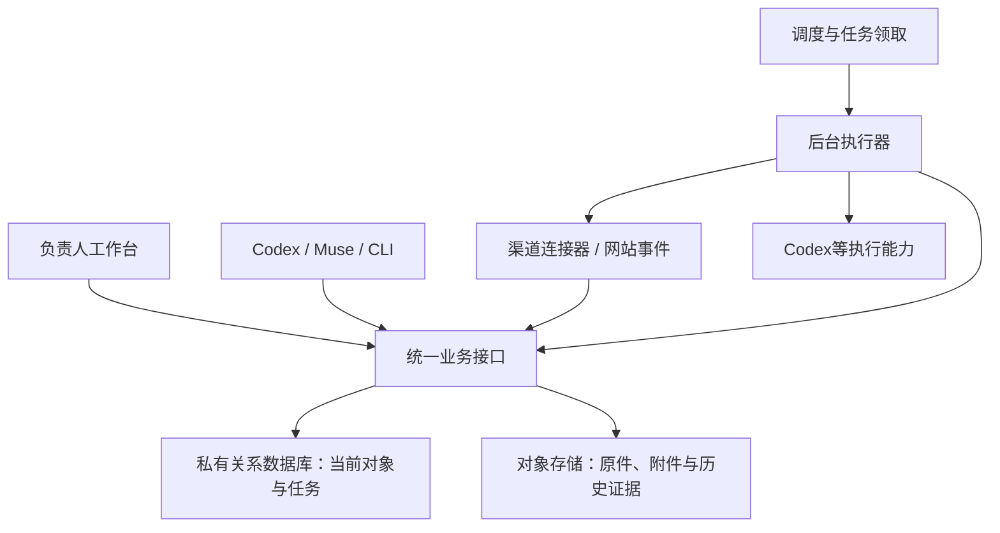

# 贝强运营系统：产品与整体架构

2026-10-30。负责人已认可自动更新和业务后端方向，并要求先深入原项目、确定整体架构。本页是运营系统产品范围、架构决策、迁移与验收的唯一设计入口；当前已经上线的能力仍以[README](README.md)为准。整体方向已获认可，本页细化方案是下一阶段实施依据，不代表各模块已上线、服务已购置或平台已接通。

## 产品目标与取舍

让负责人在任何设备上调整方向、查看真实经营变化、启动工作和审阅成果；让不同Agent取得同一对象的当前依据，提交结果并继续推进。日常使用不再需要导入JSON、复制云执行指令或翻旧聊天拼接进度。

采用一个模块化业务后端，供工作台、渠道连接器、CLI/MCP和Agent共用。先用一个应用与一个独立执行进程，不建设微服务、通用低代码平台或另一套完整ERP。普通采集、去重、计算和状态更新由程序完成；研究、判断、文案与代码工作才使用模型。

产品围绕经营对象组织，而不是围绕聊天组织。项目、任务、渠道账号、业务记录、资料与成果有稳定ID；聊天是工作入口和过程，不是事实来源。现有产品资料保留为客户自主选款的依据，本轮不建设产品推荐排名或主推款功能。

## 原项目盘点与业务范围

本次查阅总控、产品、国际站、网站源码、客户开发、市场研究、抖店、内容创作、知识与工具入口，并检查现有接口及执行器。没有改变客户跟进、平台商品、视频项目或其他对话的在制成果。下表中的“已有”表示项目文件或实现有证据，不能由此推断所有功能都经过真实订单验证。

| 业务域与依据 | 已有基础 | 系统应补齐什么 |
| --- | --- | --- |
| [产品与供给](../../00_总控台/产品中心/README.md) | 产品、供应来源、渠道商品已分开维护；原件、别名、素材索引可追溯 | 同一产品跨渠道查询、供货/声明证据、资产访问及变更影响；不重新编号或复制主库 |
| [国际站](../../02_Alibaba运营/AGENTS.md) | 商品全生命周期SOP、官方OpenAPI客户端、商品档案与正式回读 | 商品问题进入任务，具体字段差异审阅，提交/审核/公开状态及效果关联 |
| [独立站](../../03_独立站/README.md) | 源码已有询盘、消息、报价、样品、订单准备、履约、复购、文件与统计接口 | 统一内部入口和事件流，复用原业务规则；先核每条接口的实际接入与验收范围 |
| [客户开发](../../04_客户开发/README.md) | 既有CRM、客户项目、RFQ岗位、开发与送达率方法、候选发现工具 | 候选到机会的关联、需求/异议、下一动作、报价/样品/订单及收益；RFQ自动岗位仍暂停 |
| [市场研究](../../06_市场研究/README.md) | 市场、竞品与获客研究有来源和日期 | 研究发现关联具体经营问题、实验与结果，不只堆报告或名单 |
| [国内抖店](../../09_国内电商/抖店/README.md) | 逐店商品/SKU、妙手执行、图文与罗盘离线分析 | 店铺隔离、内容到支付、发货退换和贡献利润；平台未提供可靠接口的保留正常导入 |
| [内容与独立创作](../../05_内容与视频/README.md) | PROJECT、参考库、生成/剪辑工具、作品版本及观看反馈 | 同一作品的需求、资产、审片、修订与交付；独立创作不强制SKU或成交目标 |
| [电商Agent](../07_电商Agent/README.md)、[渠道接口](../04_MCP与Workctl/渠道接口与插件.md) | 已有21个准备/审核工具、字段差异、来源失效检查；部分官方客户端可用 | 将准备结果接到统一任务/成果，不把插件的本地运行库升级成第二份业务主库 |

特别发现：部分渠道范围JSON或视频项目内的店铺描述落后于店铺当前档案。因此，来源优先级按字段归属确定，不能简单取“文件最后修改时间最新”的整篇文章。历史制作背景保留，当前店铺状态读店铺对象；发现冲突形成修订任务，不能让模型自行选一个数字写回。

业务保留三条独立链：国际B2B的需求→采购讨论→报价/样品→订单/履约→复购；国内零售的内容/商品→选规格→支付→发货→退换；独立创作的目标→制作→观看修订→作品验收。共用资料、执行和审阅能力，不共用转化阶段或利润口径。

## 使用体验与信息结构

一级入口建议为**总览、业务、工作、资料、设置**，业务内再按国际站、独立站、客户开发、抖店、内容创作进入。研究成果随相关业务对象呈现，知识方法可从资料检索；不把每个工具或每个Agent做成一个菜单。

- **总览**回答当前重点、有哪些变化、什么需要我决定、哪些工作正在推进；按业务筛选。数据卡片点开能进入原对象，未知或未接入明确显示，不用空数字伪装正常。
- **业务对象页**集中显示当前事实、关联文件、往来/变更、下一动作和成果。客户、商品、渠道页面、视频项目按各自需要呈现，聊天入口附在对象旁。
- **工作区**支持自然语言发起、现有流程快捷发起、继续原任务、补充要求、审阅差异和查看产物。简单任务不强制填项目计划；系统从当前对象补上下文，真正缺失的信息集中询问。
- **资料区**支持按款号、客户、项目、平台ID检索，查看图片/视频/PDF预览及当前版本；原件可定位，可复用素材不重复上传。
- **设置区**集中连接状态、自动化规则、执行资源、预算与额度、数据导出。每条自动化能看触发条件、作用对象、允许动作、执行记录和暂停开关。

手机优先完成查看变化、调整重点、补充信息和审阅；电脑承接密集字段编辑、资料整理及制作。用户不应被要求理解run_id、租约、JSON或数据库表名才能完成日常操作。首版沿用现有登录，不另造用户中心。

## 共用对象与模块边界

| 模块 | 关键对象和关联 | 不混淆的内容 |
| --- | --- | --- |
| 经营方向 | 长期目标、阶段结果、当前重点、资源约束、关联项目 | 目标不是任务清单；任务必须说明帮助哪个结果 |
| 产品供给 | Product、SupplySource、证据、渠道Listing、SKU、Asset | 产品身份≠平台商品≠库存；渠道/店铺价格与履约独立 |
| 客户经营 | Company/Contact、候选、Inquiry、Opportunity、Conversation、Quote、Sample、Order引用 | 一家公司可有多次机会；邮件线程不是客户主键；不按名字近似自动合并 |
| 渠道经营 | ChannelAccount/Store、Listing/Page、发布变更、指标窗口、来源活动 | 同平台不同店铺隔离；公开页面和后台审核各有状态 |
| 内容研究 | ResearchFinding、ContentProject、ArtifactRevision、Publication、Feedback | 观察≠结论；产物≠发布；独立作品允许无Product关联 |
| 订单经营 | 报价版本、承诺依据、成本项、收付款/履约记录或外部引用 | 先辅助决策和接续，不替代平台订单、银行账或完整ERP |
| 执行协作 | WorkItem、Run、Step、Proposal、Decision、ActionReceipt、SourceRef | 任务业务结果、Agent进程状态、外部动作状态分别维护 |

以上是逻辑边界，不要求首版建齐所有表。每个模块用明确字段及外键/唯一标识，不采用把所有业务塞进一个任意JSON对象的通用表。暂未迁移的对象只登记定位和访问方式，正文仍在原源。

来源引用至少能说明对象ID、权威位置、读取版本、证据位置、来源时间与采集时间；正式数据统计另带期间、时区、币种、口径。资产索引记录存储位置、哈希、访问范围、关联对象；本机路径或E盘Junction只作现有位置，不能当跨设备下载地址。

供货承诺按具体对象保存事实、适用条件和待确认项。技术开发询盘继续区分买家目标、已确认能力、不可调整项和打样实际结果；不能用一个全局“工厂能力”文本替代具体证据。

## 当前系统中应保留与更换的部分

| 现状证据 | 判断与改造 |
| --- | --- |
| 官网已有管理员登录、总控编辑、任务/运行/审阅界面 | 保留页面与既有访问边界，减少反复改界面 |
| 网站已有 `api/inquiries.js`、`api/admin/inquiries.js`、`api/admin/analytics.js` 等业务后端，读取询盘、消息及经营事件 | 首先接入这些原业务记录；不从文件复制出第二份网站CRM，不要求买家重复填资料 |
| 工作台 `_lib/workbench.js` 按对象列出历史版本并逐个读取，找到当前版本；存在单对象/全类型读取上限 | 私有关系库保存当前行与关系，按需取历史；对象存储继续保存原始证据和附件 |
| 原文、任务与目标导入是多次独立写入；版本号保护单条写入 | 对有关联的当前对象修改、变更记录和待执行事件采用同一数据库事务 |
| 任务执行仍需人工指定Cloud运行；租约过期只在部分读取中显示中断，旧占用需处理 | 后端拥有持久队列、原子领取和中断恢复，执行器报告真实进度；仅无外部副作用任务可按既定策略有限重试 |
| `prepare-status.py` 读取历史经营档案和手动额度输入 | 保留作为历史导入工具；自动更新必须调用真实来源，重复导入旧文件不能算完成采集 |
| 部分资料只有本机可读、桌面插件能用，原始客户资料不在公开仓库 | 逐项建立服务端连接和私有资料入口，不能把本地登录或聊天插件视为后端已获访问能力 |

## 必须具备的产品能力

| 能力 | 用户实际能做什么 | 完成依据 |
| --- | --- | --- |
| 经营总控 | 调整目标、当前重点、优先级、暂停范围及可投入资源；看到受影响的工作 | 保存后相关新任务读取同一版本；已排队/运行任务是否调整明确显示，不静默改写 |
| 待处理事项 | 集中看到真实新询盘、待审成果、失败任务、需要补充的决定 | 每项能打开对应对象、说明产生原因并完成下一动作；已处理事项退出待办 |
| 渠道工作区 | 查看独立站、国际站的当前状态、数据期间、变化及对应操作 | 数据直接来自原服务或自动采集；既能手动刷新，也能看到最近成功和当前失败原因 |
| 对象与资料检索 | 找到某项目/客户/商品/渠道记录的原件、关联成果、当前判断和主办 | 搜索返回稳定对象和证据；换聊天不新建一份事实库，不要求用户反复上传已有资料 |
| 执行中心 | 明确发起工作、看当前步骤、暂停/取消、补充信息、审阅结果 | 一个任务关联用户要求版本、执行器、进度、产物和业务回写；失败/未领取不显示完成 |
| 成果工作区 | 看文案、页面、文件和结构化变更，比较改前改后，采纳或要求修改 | 采纳后原业务对象更新；涉及平台的动作显示提交、回读、生效的实际阶段 |
| 连接与资源管理 | 查看每项能力是否可读/可写、连接是否有效、额度何时重置 | 连接状态按具体操作验证；Codex套餐、API费用和第三方额度分别展示，未知不填0 |
| 效果复盘 | 把一次改动或一项投入关联到之后的业务结果 | 保留统计口径、时间与对象对应，区别观察和因果推断；不以Agent运行数充当经营结果 |

首页优先呈现当前重点、重要变化、待决定事项和正在执行的工作；完整表格与底层运行细节放二级页面。支持筛选、保存视图和打开原平台。通知只针对需要行动的变化、完成或失败，不反复播报无变化状态。

## 自动更新如何工作

“自动”至少包括三条链：来源变化自动进入业务记录；任务自动派发并回传；已确认结果自动更新正确的权威对象。页面轮询仅改善显示，不能代替前两条。

| 来源 | 首选更新方式 | 必须区分的状态 |
| --- | --- | --- |
| 自有网站询盘、业务消息和后台修改 | 在原业务保存链路产生事件，触发总控待办；总控直接查原业务服务 | 已收到、待处理、已处理，以及邮件通知是否成功分别保存 |
| 自有网站发布与可用性 | 发布完成事件加轻量健康检查 | 部署完成、公开页面可访问、表单链路可用分别判断 |
| 国际站商品/审核状态 | 按已验证官方接口增量读取，操作后回读；有可用平台事件则优先使用 | 平台状态与实物、自产、库存事实分开 |
| 国际站经营报表 | 按接口权限和平台出报频率采集；接口不覆盖时保留明确人工导入项 | 数据日期、统计时区、完整性及是否跨商品去重，不承诺未验证接口 |
| Search Console | 通过可在后端使用的授权接口读取，按平台已结算窗口更新 | 今天采集不代表今天的搜索数据，不能把有展示页面数当索引总数 |
| Codex额度 | 经已登录、实际在线的Codex执行端读取官方额度接口，按需/运行期间更新摘要 | 账户共享额度、各窗口、重置时间；执行端离线显示最后结果及离线状态 |
| Agent工作 | 后端队列提交，执行器领取、报告进度、提交成果 | 排队、已领取、运行、等待输入、待审、成功、失败、取消；必须可恢复 |

采集频率依据业务变化和来源限制配置，不对所有接口每几秒全量抓取。模型不参与普通轮询；来源未变化不重新分析。来源失败保留上次成功记录并显式标记过期，不能伪造新采集时间或抹成0。

## 后端职责与存储建议

建议关系库选PostgreSQL路线，使用当前对象、关系、任务状态与变更记录所需的事务和索引；本轮不因选库创建新服务。保留现有私有对象存储用于附件与证据，不把所有Blob版本重新搬成数据库大字段。网站询盘原服务先通过统一接口接入，只有实际迁移该对象时才切换存储，不一次重写全站。

业务API与执行进程共享一套业务规则；界面与Agent都通过同一修改接口写入预期版本。任务队列初版可以直接由关系库承载，不预先增加Redis、消息集群和分布式锁。执行器独立于网页请求，电脑关闭后仍能继续已授权的后台工作。浏览器自动化能力按实际需求单独接入，不成为所有采集的默认方案。

基础接口需覆盖：当前经营方向；对象查询和关联；任务创建/领取/进展/取消；成果审阅与回写；连接健康与采集触发；变化和待办。Agent获取的是任务相关对象、版本及证据入口，不是把全部项目塞进提示词。先做好对象检索和按需读文件，不先建设复杂向量知识库。

### 实现结构与现有代码归属

建议继续用现有网站的TypeScript/JavaScript技术栈承接业务API与管理界面，已有Python客户端保留为适配器，不为统一语言重写成熟工具。业务模块和队列规则共享；网页请求进程、后台执行进程可分别部署。先在网站独立仓库组织模块，经营仓库继续保存方法、设计和独立工具，不新建第三套源码或任务状态。

| 层 | 责任 | 现有代码或下一步落点 |
| --- | --- | --- |
| 页面与身份入口 | 手机/桌面访问、对象导航、审阅与设置 | 复用 `app/admin/workbench/`；买家页面保持自身访问边界 |
| 业务服务 | 询盘、报价、商品、内容、任务的字段及阶段规则 | 从 `edgeone-deploy/cloud-functions/api/` 和 `_lib/` 提取共用服务；不要误用根目录演示API |
| 数据访问 | 类型化当前行、版本、关系、分页查询 | 新增PostgreSQL适配；目前 `db/schema.ts` 为空，不是已投产关系库 |
| 后台执行 | 采集、持久队列、触发Agent、回收进度/结果 | 与业务服务共享代码；独立于短时HTTP请求运行 |
| 能力适配 | 官方平台API、Codex、既有CLI/MCP、正常浏览器操作 | 复用原客户端和Skill；只把已核输入/输出的工具接成可执行能力 |
| 文件与证据 | 原件、附件、正式回读、大媒体、预览 | 保留对象存储与本地原件；只按需要上传私有可访问版本 |

内部接口按 `/api/ops/v1/` 命名，包含control、inbox、tasks、runs、proposals、connections、assets及各领域路由；对象关联查询可统一，业务修改仍用具体领域接口。旧网站公开路由继续调用相同业务服务，避免突然改买家链接。CLI/MCP是这些接口的薄客户端，不再各维护一套当前业务状态。

首批关系表覆盖控制版本、任务、运行/事件、提案/审阅、连接/采集游标、待办、来源引用和待处理事件。询盘/消息表随网站对象迁移加入，其余业务按真实流程扩展。当前态用索引分页查询，历史按对象加载；不再每次全列Blob版本求最新。现有询盘读取500条和工作台历史读取边界须在对应迁移中解除，不能把读取上限内的数量展示为全部业务总数。

数据库事务用于一次内部修改、变更记录及待处理事件的一起保存，避免半次完成；PostgreSQL并发机制可支持这类设计，具体隔离和条件更新在实现时按冲突场景验证。[官方事务说明](https://www.postgresql.org/docs/current/transaction-iso.html)。网站原Blob记录在迁移前不能假装与新数据库拥有同一事务：现有询盘没有统一单调版本，updatedAt也未覆盖全部写入口。过渡期按原reference/key及消息/动作ID去重，通过重叠时间窗或有限全量核对补查遗漏；不能仅靠一个时间游标。并发保存需先迁该对象，或统一其全部写入口实现条件更新，新适配器本身不能解决原JSON覆盖。迁移后切到同库事务，不额外建设事件溯源平台。

### 执行、授权与协作协议

任务保存目标、业务对象、当前依据版本、主办、允许动作、完成依据和资源预算；运行保存真实执行器、开始/心跳/结束、步骤、产物及错误。模型发起的多个步骤仍属于同一工作任务，不能用多个Agent制造重复待办。

业务状态、运行状态和外部动作状态分开：

- 业务任务：待处理、进行中、等依赖/决定、已完成、取消；只有成果达到该任务的验收才完成。
- Agent运行：排队、已领取、执行、等待输入、待审、结束/失败/中断。进程结束不直接代表业务完成。
- 平台动作：准备、提交中、平台接受、回读确认、正式生效或失败；邮件发送回执不直接表示进入收件箱或得到真人回复。

正常程序负责采集、计数、数值核算、差异、重复检查、触发和状态；专业Agent负责研究、判断、文案和实现；统筹负责取舍、依赖和重要成果审查；负责人只补实际能力、商业决定和必须由本人完成的授权。不把每一步常规操作推回负责人，也不让所有草稿都自动获得外发权。

复用已授权动作的原对象和范围，系统保存授权依据/范围而不是每次再问。外发、平台修改、付费生成使用各自业务规则；付费视频仍按当次确认，RFQ暂停状态作为明确开关继承。权限或对象改变时才核新增范围。采集连接有效与业务动作获授权是两件事。

首版只有负责人一个人工管理员，不做复杂组织架构。当前owner登录、旧网站管理Bearer、买家会话、runner机器身份不同；A包将内部浏览器操作统一到owner会话及CSRF校验，旧admin路由调用同一授权函数，原管理页面及脚本纳入兼容/停用清单，不让新页面继续索取旧Bearer。保留买家隔离。执行器使用可撤销、按用途限制的服务身份，只获取任务必要资料，不把owner登录或渠道密钥交给模型。机器令牌保留服务端用途，浏览器不得保存服务器管理凭证。

独立业务对象可并行；同一对象的正式写入、同仓库main提交串行。已有文件写入者继续原任务，云迁移不抢占；原桌面对话未接入系统时标“外部主办/待同步”，不得显示其正在运行或宣称总控要求已广播。保留会话链接但不以会话作为事实库。

队列原子领取，租约到期由后台持久标中断并释放占用；恢复沿原任务及证据判断已做步骤。外部动作保存唯一动作标识与正式回执，回包丢失先查状态，不盲目再次发信/发布。数据库队列及条件更新足够，不引入全局文件锁服务。失败时说明问题和下一动作，不堆自动重试层。

### 自动化、资料访问与运维

自动化规则保存触发来源、条件、对象范围、允许动作、暂停状态和资源上限。先接事件驱动的待办及只读采集，再开放经过验收的操作；周期按来源出报和真实响应需要设置，不能用固定模型定时轮询替代程序。无变化不通知、不重复生成方案。同一业务变化只保留一个活动待办，处理后能退出。

连接登记到具体账号/店铺和操作，分别显示可读、可写、凭证是否有效、运行位置、最后成功/失败和覆盖范围。桌面工具、本机浏览器、云服务有不同可用条件；需要本机/E盘的任务明确显示等待本机资源，不承诺电脑关机也能生成本地大视频。先让不依赖本机的任务真正独立运行。

Agent按对象查询事实、读必要原件、提问和提交成果，服务端控制访问。产品图片/轻量预览可按需求云化；大原始包与视频按项目选择转存，记录哈希和引用。资料未可达时提出具体文件缺口，不让用户整盘上传，也不以公开Git承载私有成本/订单/客户原件。

数据库采用可恢复备份并验证一次恢复；对象原件保留，迁移不删除原文件。状态页展示执行队列、连接失败和最近成功，费用分别记录托管、第三方、模型/API和付费素材；Codex账户额度不能当本项目独占预算。首版只收集支撑诊断的记录，不建设大规模监控平台。

程序更新沿现有main、必要测试及发布验收；业务数据更新不应触发整站重新部署。Agent可准备代码变更，不能把“自动更新数据”解释成模型自行升级生产程序或安装任意新工具。

## 唯一来源如何迁移

唯一来源不等于所有信息都塞进一个文档，也不等于网页、本机、平台都能各自任意改同一字段。

| 信息 | 目标权威位置 | 本地/历史如何保留 |
| --- | --- | --- |
| 负责人执行要求、任务当前状态、运行和审阅 | 私有业务后端 | 本地读取或导出；不再独立编辑另一套当前状态 |
| 平台审核、在售与经营数据 | 外部平台；后端保存带来源的同步结果 | 原始回读作为证据，历史统计按期间保存 |
| 已确认公司与产品事实、客户业务记录 | 按对象迁移的私有业务记录 | 切换前仍沿原文件；切换后本地为受控工作副本或导出，禁止双主覆盖 |
| 代码、方法、SOP与架构说明 | 对应Git仓库 | 沿当前main和精确范围协作，不把私有客户记录放进公开仓库 |
| 原始包、附件和正式回执 | 原件或私有对象存储 | 原始资料保留，业务对象引用稳定资产ID及来源 |

逐类切换，先迁负责人要求和任务，再接渠道对象，后续才迁客户及产品等资料。每类对象切换时核当前记录、ID、数量与引用，宣布哪个入口可写；已有运行绑定的依据版本保留到任务结束。不能一边宣布数据库权威、一边让Agent继续无条件覆盖本地原文。

队列切换时短暂暂停新领取，按记录保留排队任务、control/document依据历史、待审提案、claims/active关系及租约；正在运行的工作先排空，确需中断则记录并由同任务接续。停用旧领取端后才开放新队列，不允许Blob和数据库同时派发同一任务。回退也须先停止新写/领取并核切换后的变更，不能直接恢复旧库覆盖新成果。

快照保留在历史证据、导出和缓存层；用户日常操作不再围绕“导入快照”展开。底层保存历史是为了追溯真实变更，不是再建第二套经营事实。

## 运行条件与已核边界

- 现有网站已经有云端后端，可以复用登录、接口与业务处理，并非从零买一台机器才开始。
- EdgeOne官方配置文档列出Cloud Functions单次10–120秒、默认30秒；文档所列定时任务最小间隔为一天。适合短接口和部分采集，不能据此假定可承载持续模型执行或分钟级调度。本项目实际套餐及配置支持仍须在实施时验收。
- Codex官方CLI文档及本机 `codex cloud exec --help` 均确认可提交指定环境的云任务，另有status/list接口。项目现在人工复制指令是接入现状，不是官方永远没有程序化入口。该命令仍标Experimental；现有Cloud文档记录过CLI选择器未列出本项目新版环境，因此“存在提交命令”和“可自动提交到本项目已发布环境”仍须分开验证。指定Sol、环境、身份续期、结果归属与中断恢复须端到端验收后才能开启自动派发。
- 官方Codex App Server提供 `account/rateLimits/read` 和更新通知。它需要可用的认证执行端，不把桌面工具直接假定为网页可调用的公共API。
- Codex Cloud承接Agent任务；公司的当前业务记录、渠道连接和持久调度应由业务后端掌握。需要持续执行的部分可用托管容器/作业服务，不强制购买传统云主机。服务商、区域、费用和凭证配置待具体部署方案核实，不在本页虚定免费或无限额度。
- ChatGPT内插件授权与服务器连接授权是不同接入条件；现有Alibaba客户端凭证在本地外部配置，不能复制进公开源码或把插件登录态搬运为后端凭证。

官方核验于2026-10-30：[EdgeOne配置与运行限制](https://pages.edgeone.ai/document/edgeone-json)、[Codex云任务命令](https://learn.chatgpt.com/docs/developer-commands#codex-cloud)、[Codex额度读取](https://learn.chatgpt.com/docs/app-server#6-rate-limits-chatgpt)。上述来源证明产品提供的能力，不证明本项目已接通或全部可用。

## 实施顺序与验收

### 交付包与完成门槛

| 交付包 | 范围与依赖 | 能交付给负责人的结果 |
| --- | --- | --- |
| A：共用内核与首条业务流程 | 确定私有数据库/后台运行部署条件；先迁总控和任务，接入原网站询盘、消息、统计及统一身份。对象索引和持久待办只做首条流程需要的范围 | 收到网站询盘→出现待办→打开同一对象/资料→生成处理提案→审阅→回原记录；不用导入JSON，不重复建客户 |
| B：自动采集与真实派发 | A的队列、版本及访问生效；接国际站已验证只读接口，网站事件，额度及可用搜索数据；验证本项目Cloud自动提交与回传 | 离开本机后指定采集和已授权工作继续完成；看得见失败和新结果，重复采集不新增重复任务 |
| C：业务操作与跨设备资料 | 按具体机会/商品/内容项目补齐必要私有资料，逐个接既有执行工具及字段回写，不批量迁全盘 | 商品变更从差异到正式回读；客户需求到可审报价/样品条件；内容从资产到可审作品，各走原规则 |
| D：经营复盘与扩展 | 已有真实运行和业务结果，按瓶颈扩国内数据/社媒/广告/履约等 | 每项投入能对应实际结果和成本，决定保留、调整或停止；新渠道复用内核，不复制另一套系统 |

同包可按独立文件/对象并行，但A的验收优先；不等所有渠道接完才交付，也不在A只做一个大看板。当前尚未开始A的代码改造，本轮完成整体架构及范围。下一执行主办为统筹Codex，Sol按API/数据内核、界面、适配器独立分工，集成与提交串行；原客户/店铺/内容项目仍由原主办处理。

### 必须跑通的业务场景

1. **询盘到处理：** 有标识的测试询盘只生成一个原记录和一个活动待办；通知失败不丢询盘。打开同一reference，回复/处理记录回原对象；真实外发仍在相应授权内。
2. **并发消息：** 买家消息与管理员修改下一步同时发生，两者都保留；网站记录迁移前先测现有适配，不能把简单JSON覆盖当并发已解决。
3. **跨设备总控：** 两设备看到同一要求版本，新任务使用新版本；旧任务保留依据且明确是否重排；并发修改不静默覆盖。
4. **中断接续：** 执行进程中断后后台释放过期占用并记录中断；重新接续能判断哪些步骤已完成，旧执行器不能继续提交结果。
5. **提案与唯一来源：** 审阅前不改变业务事实；原对象被其他任务修改时旧提案需重新核差异；采纳只更新目标字段及关联结果。
6. **商品闭环：** 读取一个已授权渠道商品→准备字段差异→适用授权内提交→官方回读→必要公开验收→更新对应本地/后端唯一档案，不覆盖别款或另店。
7. **采集失效：** 来源失败显示上次成功及过期，恢复后更新原对象；不存在假0和以旧报告冒充今天数据，罗盘等人工入口仍明确标注。
8. **云端独立：** 关闭本机和浏览器后指定只读采集及有界Agent任务仍完成并回传；若需人工启动则标明该项未通过。
9. **业务分域：** 两个抖店分别呈现商品、支付/退款窗口；独立创作可建无SKU作品并完成审片，不强制填采购阶段。
10. **结果与停用：** 订单准备不齐不能标已成交，样品发出不等于验收通过；外部回包丢失先查证不重复动作；RFQ暂停在服务重启/额度恢复后仍保持。

### 后续能力的进入条件

| 候选能力 | 值得接入的原因 | 何时进入实现 |
| --- | --- | --- |
| 买家发现与定向开发 | 已有候选助手和CRM核对，接回复/停止状态可减少重复查找及无效联系 | 具体客群与渠道可核，原CRM及邮件读取/写回路径可用；不因系统上线扩大外发范围 |
| 邮件诊断与跟进 | 汇总退信、真实回复、缺资料及下一动作 | 连接现有邮箱后按账户/线程取证；第三方warmup和购买名单不是默认功能 |
| 报价、成本及资金安排 | 同一需求复用产品证据、计算费用并比较条件 | 有真实供货路径及订单参数；未知项明确，按订单口径输出，先不建财税系统 |
| 样品、履约与复购 | 减少遗漏验收、出货与补单信号 | 具体机会进入对应阶段，复用网站现有规则及原交易平台证据 |
| SEO、社媒与广告实验 | 把页面/内容修改和采购或零售效果关联 | 账号和数据接口可用，目标/观察窗口明确；P4P或投放预算按原授权，不因架构自动开投 |
| 内容生产与分发 | 复用真实素材、反馈和批准版本，减少重复生成和错发 | 现有作品项目先接审阅与资产，付费生成和正式发布逐能力验收 |
| 供应与产品资料扩展 | 客户自主选款时可查齐货源、色码、条件及证据 | 当前业务需要，逐对象迁移；不建立无实物的概念产品库 |
| 更多平台/知识检索 | 复用统一对象、资料和工具调用 | 有明确业务使用和可核接口；小红书、微信、Amazon等按实际经营状态进入，不预建空后台 |

### 提效如何衡量

先用A的原流程记录人工搬资料、重复查找、跨工具切换和处理耗时的基线，再比较同类工作，不预设未经测量的提效百分比。系统内记录从事件出现到可处理、首次有效处理、审阅完成的时间；分别标等待负责人、客户或工厂，不能把外部等待归为系统效率。

关注每项成果所需的人工补充/搬运次数、返工原因、来源冲突、需人工恢复次数和运行/第三方费用；结合业务分别看合格采购讨论与订单贡献、零售退换与贡献、作品验收。模型token、运行次数、页面数只解释投入，不能单独证明系统有价值。没有改善真实流程的模块不继续扩建。

### 尚需实施验证的决定

产品边界、模块化后端、共用API、PostgreSQL路线、数据库队列、原件存储和逐对象迁移作为本方案基线。尚未选定托管服务商/地区/计费档位；实施前以现有EdgeOne连通、私有数据库访问、后台调度/执行、备份与费用核实部署组合，不先购买GPU或假定必须新云主机。

需要具体验证：本项目已发布Cloud环境能否程序化调用Sol及稳定回传；现有网站管理身份如何接入owner会话；Alibaba/GSC/邮箱等在服务器上的正式授权；私有媒体与客户原件的最小可达范围。可先用已有资料和本地受控试验推进接口/数据设计，依赖不足不得把自动化标成上线；只有实际需要新增付费或本人授权时才集中给负责人具体选项。

阶段按结果和依赖推进，不定日历工期。首个验收围绕内部业务流程，不绑定主推鞋。完成标准是用户能够改变方向、取得当前依据、推进工作、收到可核结果；页面数、连接器数、Agent数不作为完成指标。
