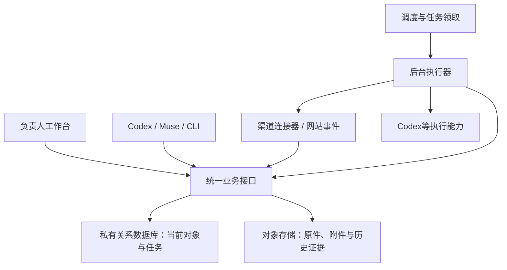

# 经营工作台产品与后端需求

2026-10-30。负责人要求重新审视工作台：支持自动更新，由后端支撑业务运转，先打磨内部能力，不以主推鞋组织工作。本页维护产品需求和架构建议；当前已经上线的能力仍以[README](README.md)为准。下列目标架构尚未实施，不把设计写成已接通。

## 产品目标与取舍

让负责人在任何设备上调整方向、查看真实经营变化、启动工作和审阅成果；让不同Agent取得同一对象的当前依据，提交结果并继续推进。日常使用不再需要导入JSON、复制云执行指令或翻旧聊天拼接进度。

采用一个模块化业务后端，供工作台、渠道连接器、CLI/MCP和Agent共用。先用一个应用与一个独立执行进程，不建设微服务、通用低代码平台或另一套完整ERP。普通采集、去重、计算和状态更新由程序完成；研究、判断、文案与代码工作才使用模型。

产品围绕经营对象组织，而不是围绕聊天组织。项目、任务、渠道账号、业务记录、资料与成果有稳定ID；聊天是工作入口和过程，不是事实来源。现有产品资料保留为客户自主选款的依据，本轮不建设产品推荐排名或主推款功能。

## 当前系统中应保留与更换的部分

| 现状证据 | 判断与改造 |
| --- | --- |
| 官网已有管理员登录、总控编辑、任务/运行/审阅界面 | 保留页面与既有访问边界，减少反复改界面 |
| 网站已有 `api/inquiries.js`、`api/admin/inquiries.js`、`api/admin/analytics.js` 等业务后端，读取询盘、消息及经营事件 | 首先接入这些原业务记录；不从文件复制出第二份网站CRM，不要求买家重复填资料 |
| 工作台 `_lib/workbench.js` 按对象列出历史版本并逐个读取，找到当前版本；存在单对象/全类型读取上限 | 私有关系库保存当前行与关系，按需取历史；对象存储继续保存原始证据和附件 |
| 原文、任务与目标导入是多次独立写入；版本号保护单条写入 | 对有关联的当前对象修改、变更记录和待执行事件采用同一数据库事务 |
| 任务执行仍需人工指定Cloud运行；租约过期只在部分读取中显示中断，旧占用需处理 | 后端拥有持久队列、原子领取和中断恢复，执行器报告真实进度；仅无外部副作用任务可按既定策略有限重试 |
| `prepare-status.py` 读取历史经营档案和手动额度输入 | 保留作为历史导入工具；自动更新必须调用真实来源，重复导入旧文件不能算完成采集 |
| 部分资料只有本机可读、桌面插件能用，原始客户资料不在公开仓库 | 逐项建立服务端连接和私有资料入口，不能把本地登录或聊天插件视为后端已获访问能力 |

## 必须具备的产品能力

| 能力 | 用户实际能做什么 | 完成依据 |
| --- | --- | --- |
| 经营总控 | 调整目标、当前重点、优先级、暂停范围及可投入资源；看到受影响的工作 | 保存后相关新任务读取同一版本；已排队/运行任务是否调整明确显示，不静默改写 |
| 待处理事项 | 集中看到真实新询盘、待审成果、失败任务、需要补充的决定 | 每项能打开对应对象、说明产生原因并完成下一动作；已处理事项退出待办 |
| 渠道工作区 | 查看独立站、国际站的当前状态、数据期间、变化及对应操作 | 数据直接来自原服务或自动采集；既能手动刷新，也能看到最近成功和当前失败原因 |
| 对象与资料检索 | 找到某项目/客户/商品/渠道记录的原件、关联成果、当前判断和主办 | 搜索返回稳定对象和证据；换聊天不新建一份事实库，不要求用户反复上传已有资料 |
| 执行中心 | 明确发起工作、看当前步骤、暂停/取消、补充信息、审阅结果 | 一个任务关联用户要求版本、执行器、进度、产物和业务回写；失败/未领取不显示完成 |
| 成果工作区 | 看文案、页面、文件和结构化变更，比较改前改后，采纳或要求修改 | 采纳后原业务对象更新；涉及平台的动作显示提交、回读、生效的实际阶段 |
| 连接与资源管理 | 查看每项能力是否可读/可写、连接是否有效、额度何时重置 | 连接状态按具体操作验证；Codex套餐、API费用和第三方额度分别展示，未知不填0 |
| 效果复盘 | 把一次改动或一项投入关联到之后的业务结果 | 保留统计口径、时间与对象对应，区别观察和因果推断；不以Agent运行数充当经营结果 |

首页优先呈现当前重点、重要变化、待决定事项和正在执行的工作；完整表格与底层运行细节放二级页面。支持筛选、保存视图和打开原平台。通知只针对需要行动的变化、完成或失败，不反复播报无变化状态。

## 自动更新如何工作

“自动”至少包括三条链：来源变化自动进入业务记录；任务自动派发并回传；已确认结果自动更新正确的权威对象。页面轮询仅改善显示，不能代替前两条。

| 来源 | 首选更新方式 | 必须区分的状态 |
| --- | --- | --- |
| 自有网站询盘、业务消息和后台修改 | 在原业务保存链路产生事件，触发总控待办；总控直接查原业务服务 | 已收到、待处理、已处理，以及邮件通知是否成功分别保存 |
| 自有网站发布与可用性 | 发布完成事件加轻量健康检查 | 部署完成、公开页面可访问、表单链路可用分别判断 |
| 国际站商品/审核状态 | 按已验证官方接口增量读取，操作后回读；有可用平台事件则优先使用 | 平台状态与实物、自产、库存事实分开 |
| 国际站经营报表 | 按接口权限和平台出报频率采集；接口不覆盖时保留明确人工导入项 | 数据日期、统计时区、完整性及是否跨商品去重，不承诺未验证接口 |
| Search Console | 通过可在后端使用的授权接口读取，按平台已结算窗口更新 | 今天采集不代表今天的搜索数据，不能把有展示页面数当索引总数 |
| Codex额度 | 经已登录、实际在线的Codex执行端读取官方额度接口，按需/运行期间更新摘要 | 账户共享额度、各窗口、重置时间；执行端离线显示最后结果及离线状态 |
| Agent工作 | 后端队列提交，执行器领取、报告进度、提交成果 | 排队、已领取、运行、等待输入、待审、成功、失败、取消；必须可恢复 |

采集频率依据业务变化和来源限制配置，不对所有接口每几秒全量抓取。模型不参与普通轮询；来源未变化不重新分析。来源失败保留上次成功记录并显式标记过期，不能伪造新采集时间或抹成0。

## 后端职责与存储建议

建议关系库选PostgreSQL路线，使用当前对象、关系、任务状态与变更记录所需的事务和索引；本轮不因选库创建新服务。保留现有私有对象存储用于附件与证据，不把所有Blob版本重新搬成数据库大字段。网站询盘原服务先通过统一接口接入，只有实际迁移该对象时才切换存储，不一次重写全站。

业务API与执行进程共享一套业务规则；界面与Agent都通过同一修改接口写入预期版本。任务队列初版可以直接由关系库承载，不预先增加Redis、消息集群和分布式锁。执行器独立于网页请求，电脑关闭后仍能继续已授权的后台工作。浏览器自动化能力按实际需求单独接入，不成为所有采集的默认方案。

基础接口需覆盖：当前经营方向；对象查询和关联；任务创建/领取/进展/取消；成果审阅与回写；连接健康与采集触发；变化和待办。Agent获取的是任务相关对象、版本及证据入口，不是把全部项目塞进提示词。先做好对象检索和按需读文件，不先建设复杂向量知识库。

## 唯一来源如何迁移

唯一来源不等于所有信息都塞进一个文档，也不等于网页、本机、平台都能各自任意改同一字段。

| 信息 | 目标权威位置 | 本地/历史如何保留 |
| --- | --- | --- |
| 负责人执行要求、任务当前状态、运行和审阅 | 私有业务后端 | 本地读取或导出；不再独立编辑另一套当前状态 |
| 平台审核、在售与经营数据 | 外部平台；后端保存带来源的同步结果 | 原始回读作为证据，历史统计按期间保存 |
| 已确认公司与产品事实、客户业务记录 | 按对象迁移的私有业务记录 | 切换前仍沿原文件；切换后本地为受控工作副本或导出，禁止双主覆盖 |
| 代码、方法、SOP与架构说明 | 对应Git仓库 | 沿当前main和精确范围协作，不把私有客户记录放进公开仓库 |
| 原始包、附件和正式回执 | 原件或私有对象存储 | 原始资料保留，业务对象引用稳定资产ID及来源 |

逐类切换，先迁负责人要求和任务，再接渠道对象，后续才迁客户及产品等资料。每类对象切换时核当前记录、ID、数量与引用，宣布哪个入口可写；已有运行绑定的依据版本保留到任务结束。不能一边宣布数据库权威、一边让Agent继续无条件覆盖本地原文。

快照保留在历史证据、导出和缓存层；用户日常操作不再围绕“导入快照”展开。底层保存历史是为了追溯真实变更，不是再建第二套经营事实。

## 运行条件与已核边界

- 现有网站已经有云端后端，可以复用登录、接口与业务处理，并非从零买一台机器才开始。
- EdgeOne官方配置文档列出Cloud Functions单次10–120秒、默认30秒；文档所列定时任务最小间隔为一天。适合短接口和部分采集，不能据此假定可承载持续模型执行或分钟级调度。本项目实际套餐及配置支持仍须在实施时验收。
- Codex官方CLI文档及本机 `codex cloud exec --help` 均确认可提交指定环境的云任务，另有status/list接口。项目现在人工复制指令是接入现状，不是官方永远没有程序化入口。该命令仍标Experimental；指定Sol、环境、身份续期、结果归属与中断恢复须端到端验收后才能开启自动派发。
- 官方Codex App Server提供 `account/rateLimits/read` 和更新通知。它需要可用的认证执行端，不把桌面工具直接假定为网页可调用的公共API。
- Codex Cloud承接Agent任务；公司的当前业务记录、渠道连接和持久调度应由业务后端掌握。需要持续执行的部分可用托管容器/作业服务，不强制购买传统云主机。服务商、区域、费用和凭证配置待具体部署方案核实，不在本页虚定免费或无限额度。
- ChatGPT内插件授权与服务器连接授权是不同接入条件；现有Alibaba客户端凭证在本地外部配置，不能复制进公开源码或把插件登录态搬运为后端凭证。

官方核验于2026-10-30：[EdgeOne配置与运行限制](https://pages.edgeone.ai/document/edgeone-json)、[Codex云任务命令](https://learn.chatgpt.com/docs/developer-commands#codex-cloud)、[Codex额度读取](https://learn.chatgpt.com/docs/app-server#6-rate-limits-chatgpt)。上述来源证明产品提供的能力，不证明本项目已接通或全部可用。

## 实施顺序与验收

1. **接通自有业务服务。** 以网站现有询盘/业务事件与总控任务为首个完整流程，复用原记录。验收真实读取、日期与原件一致；新增/修改事件到达待办后可在原对象处理，不重复创建客户。
2. **建设业务数据与执行内核。** 确定私有数据库与执行环境，迁移总控要求及任务当前态；统一API、队列、版本写入及采集连接状态。验收两设备/两Agent看到同一版本，并发修改不静默覆盖，任务中断后不永久占用，已发生外部动作不重复执行。
3. **把采集与执行变成后台能力。** 先接可验证的只读渠道接口及额度读取；打通程序化Codex任务提交、进展、结果。验收关闭本机和浏览器后指定工作仍可完成，结果回原对象，未授权外发不发生；暂停的RFQ仍暂停。
4. **扩展操作与效果复盘。** 在现有授权范围内逐类接商品修改、客户动作及成果发布，沉淀可复用流程。验收平台实际结果与后端记录一致，能够说明业务改善或无效原因，再决定扩展渠道。

阶段按结果和依赖推进，不定日历工期。首个验收围绕内部业务流程，不绑定主推鞋。完成标准是用户能够改变方向、取得当前依据、推进工作、收到可核结果；页面数、连接器数、Agent数不作为完成指标。
